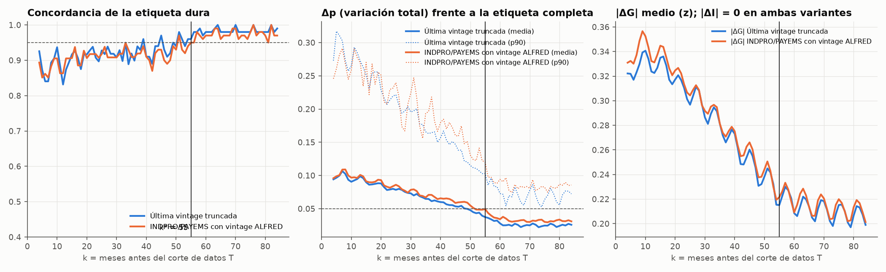

# Estudio de revisión de la etiqueta (borde derecho)

Generado por `src/labels/revision_study.py`. 100 cortes T semestrales (1975-01 → 2024-07); para cada uno se recalcula la etiqueta v1.0 solo con datos de fecha ≤ T (escalas fijas s_G = 0.4, s_I = 0.31) y se compara con la etiqueta completa en los meses T−k, k = 0…84. Solo meses objetivo con weight = 1 y etiqueta completa madura (≤ 2021-04, fuera de la ventana de tendencia truncada de la etiqueta completa).

**Variantes.** A = última vintage truncada en T (solo el efecto de cortar la muestra: ventanas centradas y tendencia truncadas). B = igual, pero INDPRO y PAYEMS con la vintage ALFRED vigente a fin del mes T+1 (añade las revisiones de datos de esas dos series; W875RX1, CMRMTSPL y la inflación siguen con la última vintage, así que B es una cota inferior de la revisión real).

**Δp** = ½·Σ|p_T − p_completa| sobre los cuatro cuadrantes (masa de probabilidad que cambia de cuadrante).

## Regla (declarada antes de ver los resultados)

k* = el menor k a partir del cual, para todo k' ≥ k, la concordancia es ≥ 95% **y** el Δp medio ≤ 0.05; se toma la variante más conservadora. La etiqueta de T termina en T−lag (lag = 4), así que `provisional_months` = múltiplo de 6 ≥ k* − lag.

## Resultado

- k* (A, última vintage) = **54**; k* (B, ALFRED) = **55** → k* = **55**.
- `provisional_months` = ⌈(55 − 4) / 6⌉ × 6 = **54** (antes 24).

## Tabla por k

| k | n | cobertura | concord. A | Δp medio A | Δp p90 A | concord. B | Δp medio B | Δp p90 B | |ΔG| A (media / p90) | |ΔI| A (media / p90) | |ΔG| B media |
|---|---|---|---|---|---|---|---|---|---|---|---|
| 0 | 0 | 0 % | — | — | — | — | — | — | — | — | — |
| 1 | 0 | 0 % | — | — | — | — | — | — | — | — | — |
| 2 | 0 | 0 % | — | — | — | — | — | — | — | — | — |
| 3 | 0 | 0 % | — | — | — | — | — | — | — | — | — |
| 4 | 94 | 100% | 92.6% | 0.094 | 0.273 | 89.4% | 0.096 | 0.246 | 0.32 / 0.71 | 0.00 / 0.00 | 0.33 |
| 5 | 94 | 100% | 87.2% | 0.097 | 0.317 | 85.1% | 0.099 | 0.261 | 0.32 / 0.70 | 0.00 / 0.00 | 0.33 |
| 6 | 94 | 100% | 84.0% | 0.100 | 0.311 | 86.2% | 0.100 | 0.281 | 0.32 / 0.64 | 0.00 / 0.00 | 0.33 |
| 7 | 94 | 100% | 84.0% | 0.107 | 0.303 | 85.1% | 0.109 | 0.291 | 0.32 / 0.64 | 0.00 / 0.00 | 0.34 |
| 8 | 94 | 100% | 89.4% | 0.102 | 0.273 | 88.3% | 0.109 | 0.268 | 0.33 / 0.64 | 0.00 / 0.00 | 0.35 |
| 9 | 95 | 100% | 90.5% | 0.093 | 0.257 | 90.5% | 0.100 | 0.245 | 0.34 / 0.77 | 0.00 / 0.00 | 0.36 |
| 10 | 95 | 100% | 93.7% | 0.091 | 0.265 | 90.5% | 0.097 | 0.258 | 0.34 / 0.75 | 0.00 / 0.00 | 0.35 |
| 11 | 95 | 100% | 88.4% | 0.093 | 0.293 | 86.3% | 0.097 | 0.290 | 0.33 / 0.72 | 0.00 / 0.00 | 0.34 |
| 12 | 95 | 100% | 83.2% | 0.095 | 0.285 | 86.3% | 0.096 | 0.277 | 0.32 / 0.74 | 0.00 / 0.00 | 0.33 |
| 18 | 96 | 100% | 87.5% | 0.087 | 0.256 | 88.5% | 0.091 | 0.237 | 0.32 / 0.82 | 0.00 / 0.00 | 0.33 |
| 24 | 97 | 100% | 89.7% | 0.080 | 0.219 | 90.7% | 0.084 | 0.231 | 0.30 / 0.77 | 0.00 / 0.00 | 0.31 |
| 30 | 98 | 100% | 90.8% | 0.073 | 0.196 | 90.8% | 0.078 | 0.224 | 0.29 / 0.72 | 0.00 / 0.00 | 0.29 |
| 36 | 99 | 100% | 89.9% | 0.065 | 0.163 | 90.9% | 0.071 | 0.196 | 0.27 / 0.67 | 0.00 / 0.00 | 0.27 |
| 42 | 100 | 100% | 89.0% | 0.057 | 0.153 | 87.0% | 0.065 | 0.170 | 0.25 / 0.64 | 0.00 / 0.00 | 0.25 |
| 48 | 100 | 100% | 92.0% | 0.050 | 0.122 | 90.0% | 0.060 | 0.148 | 0.23 / 0.61 | 0.00 / 0.00 | 0.24 |
| 54 | 100 | 100% | 96.0% | 0.039 | 0.103 | 94.0% | 0.048 | 0.122 | 0.22 / 0.59 | 0.00 / 0.00 | 0.22 |
| 55 ← | 100 | 100% | 96.0% | 0.037 | 0.103 | 95.0% | 0.049 | 0.120 | 0.22 / 0.59 | 0.00 / 0.00 | 0.22 |
| 60 | 100 | 100% | 98.0% | 0.028 | 0.073 | 97.0% | 0.034 | 0.094 | 0.21 / 0.64 | 0.00 / 0.00 | 0.21 |
| 66 | 100 | 100% | 98.0% | 0.026 | 0.071 | 97.0% | 0.032 | 0.080 | 0.21 / 0.63 | 0.00 / 0.00 | 0.21 |
| 72 | 100 | 100% | 98.0% | 0.026 | 0.070 | 97.0% | 0.031 | 0.077 | 0.20 / 0.61 | 0.00 / 0.00 | 0.20 |
| 78 | 100 | 100% | 98.0% | 0.026 | 0.073 | 98.0% | 0.031 | 0.081 | 0.20 / 0.59 | 0.00 / 0.00 | 0.20 |
| 84 | 100 | 100% | 99.0% | 0.026 | 0.072 | 97.0% | 0.031 | 0.086 | 0.20 / 0.58 | 0.00 / 0.00 | 0.20 |

k = 0…3: la etiqueta aún no existe (G necesita t+4), cobertura 0 %.

- **|ΔI| = 0** en todos los k: I(t) solo usa el índice de t−3 a t+3 (sin tendencia), y en las dos variantes la inflación usa la última vintage. Las revisiones de la inflación no están en el estudio (se miden en la escala s_I); por eso el estudio es una cota inferior de la revisión real.
- **|ΔG| no llega a 0** (≈ 0.21 z en k ≥ 70): para k ≥ 64 la ventana de ritmo y la de tendencia ya están completas en T; la diferencia que queda viene de σ_i, que se calcula con la muestra disponible en T. En probabilidades es pequeño (Δp ≈ 0.025).

**Diferencia B − A** (efecto de las revisiones de datos de INDPRO/PAYEMS): Δp medio +0.003 en k ≤ 24 y +0.007 en k ≥ 48; la concordancia baja 0.2% de media en k ≤ 24. El grueso de la revisión de la etiqueta viene del truncado (ventana centrada y tendencia) y no de las revisiones de datos.

## ¿Explica la revisión el CFNAI negativo de 2022-2024?

Correlación de G con el CFNAI agregado en la ventana de G, por antigüedad del dato (variante A, todos los cortes), con G calculado en el corte (G_T) y con la etiqueta completa (G) en los mismos meses:

| k | n | corr(G_T, CFNAI) | corr(G completa, CFNAI) |
|---|---|---|---|
| 4-11 | 755 | 0.92 | 0.97 |
| 12-23 | 1152 | 0.92 | 0.96 |
| 24-35 | 1176 | 0.92 | 0.96 |
| 36-59 | 2397 | 0.93 | 0.96 |
| 60-84 | 2500 | 0.93 | 0.95 |

- 2022-01 → 2024-04 con la etiqueta completa: corr = -0.55. Con la tendencia congelada en su último valor con ventana completa: -0.47.
- En ese tramo G tiene desviación típica 0.28 (media +0.06) y el CFNAI en la ventana de G 0.11 (media -0.11): ambos casi planos. Tramos de 28 meses en otros periodos tranquilos: 1986-01 corr 0.89 (desv. G 0.34); 1995-01 corr 0.96 (desv. G 0.46); 2004-01 corr 0.69 (desv. G 0.32); 2013-01 corr 0.84 (desv. G 0.42); 2016-01 corr 0.83 (desv. G 0.36).
- **La revisión del borde no lo explica.** Con datos jóvenes (k = 4-11) la correlación con el CFNAI es 0.92, frente a 0.97 con la etiqueta completa en esos mismos meses; en ninguna banda de antigüedad baja de 0.92. El truncado mueve G, pero no rompe su relación con el CFNAI.
- Tampoco lo explica la tendencia truncada: congelándola, la correlación de 2022-2024 sigue en -0.47.
- Es un desacuerdo de composición en un tramo casi plano: el CFNAI en la ventana de G apenas se mueve (desv. típica 0.11, media -0.11, ligeramente por debajo de tendencia: manufactura débil), mientras G (desv. 0.28, media +0.06) oscila alrededor de cero con empleo y renta real por encima de su tendencia. Es un resultado real; no hay nada que corregir.
