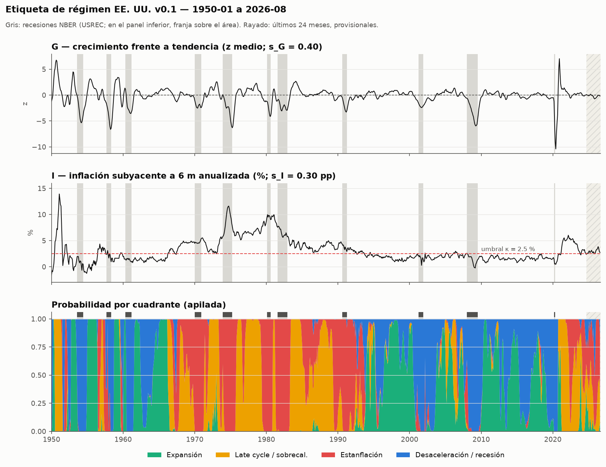

# Etiqueta de régimen EE. UU. v0.1 — comprobaciones (§8)

Generado por `src/labels/checks.py` a partir de `data/archive/labels/regime_us_v0.1.parquet` (hash de contenido `93e14c31c45f4c25…`). Muestra 1950-01 → 2026-08 (920 meses); se puntúan 896 (sin los 24 provisionales).

Las comprobaciones sirven para detectar errores de cálculo, **no para ajustar parámetros**. No se ha cambiado ningún parámetro de la ficha a la vista de estos resultados.

## 1. Escalas estimadas con ALFRED

Error de revisión = valor de **primera publicación** − valor con la **última vintage**, en las unidades del eje. Primera publicación: la vintage más antigua de cada fecha de referencia, solo si sale ≤ 75 días tras el fin del mes y no coincide con el inicio del archivo ALFRED de la serie (en ese caso no es una primera publicación). La serie de la fecha de referencia se reconstruye tal como estaba en esa vintage (incluidos t−6…t−8) y se le aplica la misma transformación que al eje. Solo fechas maduras (≤ 2024-08), para que la "última vintage" no sea a su vez provisional. s = MAD × 1,4826 del error; suelo 0,25; estable si n ≥ 60 y la MAD de cada mitad está entre ½ y 2 veces la total.

| serie / unidad | n | desde → hasta | sesgo medio | s (MAD×1,4826) | 1.ª mitad | 2.ª mitad | estable |
|---|---|---|---|---|---|---|---|
| I_PCEPILFE | 290 | 2000-07 → 2024-08 | -0.16 | 0.303 | 0.346 | 0.286 | sí |
| I_CPILFESL | 333 | 1996-12 → 2024-08 | 0.00 | 0.178 | 0.164 | 0.257 | sí |
| G_z_INDPRO | 896 | 1950-01 → 2024-08 | -0.04 | 0.617 | 0.711 | 0.547 | sí |
| G_z_PAYEMS | 831 | 1955-05 → 2024-08 | -0.07 | 0.344 | 0.549 | 0.243 | sí |
| G_composite | 831 | 1955-05 → 2024-08 | -0.04 | 0.400 | 0.522 | 0.302 | sí |

- **s_G = 0.400** (alfred): error del G de dos indicadores (media de los z de INDPRO y PAYEMS; z = error del ritmo / σ_i del indicador con datos finales). Por indicador: INDPRO 0.62, PAYEMS 0.34.
- **s_I = 0.303 pp** (alfred): PCE subyacente (la serie del eje desde 1959). El IPC subyacente (desde 1996) da 0.18 pp, menor porque el IPC solo revisa factores estacionales; se informa como contraste.
- Nota: W875RX1: sin vintages ALFRED en `vintages`; no entra en s_G. El G de la etiqueta sí usa estas series (última vintage); su ruido de revisión no está medido, así que s_G refleja solo INDPRO y PAYEMS.
- Nota: CMRMTSPL: sin vintages ALFRED en `vintages`; no entra en s_G. El G de la etiqueta sí usa estas series (última vintage); su ruido de revisión no está medido, así que s_G refleja solo INDPRO y PAYEMS.
- Las mitades de INDPRO/PAYEMS muestran que el ruido de revisión era mayor en la primera mitad de la muestra (≈ 1950-1990) que en la segunda; s resume toda la muestra.

## 2. Comprobaciones

| criterio | esperado | obtenido | |
|---|---|---|---|
| Meses NBER de recesión con P(G alto) < 0,5 | ≥ 85 % | 97.3% (n=113) | ✅ |
| Correlación G con CFNAI-MA3 (1967+) | > 0,7 | 0.62 (n=688) | ❌ |
| Correlación G con la brecha (GDPC1 vs GDPPOT), en cambios | > 0,6 | 0.87 (G vs Δ2T brecha; n=296) | ✅ |
| Episodio 1973-75 | estanflación dominante | 75% de meses en Estanflación; Estanflación 27, Late cycle / sobrecal. 8, Expansión 1 | ✅ |
| Episodio 1979-80 | estanflación dominante | 75% de meses en Estanflación; Estanflación 18, Late cycle / sobrecal. 6 | ✅ |
| Episodio 2021-T2 a 2022 | sobrecalentamiento / estanflación | 100% de meses en Late cycle / sobrecal./Estanflación; Late cycle / sobrecal. 15, Estanflación 6 | ✅ |
| Episodio 1995-99 | expansión | 78% de meses en Expansión; Expansión 47, Desaceleración / recesión 13 | ✅ |
| Episodio 2008-09 | desaceleración/recesión | 96% de meses en Desaceleración / recesión; Desaceleración / recesión 23, Estanflación 1 | ✅ |
| Episodio 2020-T2 | desaceleración/recesión | 100% de meses en Desaceleración / recesión; Desaceleración / recesión 3 | ✅ |
| Distribución por cuadrante | ninguno < 10 % | Expansión 29%, Late cycle / sobrecal. 24%, Estanflación 22%, Desaceleración / recesión 25% | ✅ |
| Duración media de los regímenes duros | ≥ 6 meses | 9.1 meses (99 tramos; mediana 5) | ✅ |
| Correlación G-I | se informa; revisar independencia si |ρ| > 0,3 | -0.02 (1984+: 0.28) | ✅ |

**Brecha de producción.** G en el último mes de cada trimestre es la variación log de la media del trimestre frente a la de dos trimestres antes, menos su tendencia; su equivalente en la brecha es Δ2T (cambio a dos trimestres), que es la medida principal. Otras lecturas (informativas): G vs Δ1T brecha 0.59; ΔG vs Δ1T brecha 0.62; G vs nivel de la brecha 0.47. GDPPOT (CBO) se lee de la vista `forecasts` (pit_role = forecast), solo hasta el último GDPC1.

**Recesiones con P(G alto) ≥ 0,5** (3 meses): 1960-05 (1.00), 1960-06 (0.70), 1973-12 (0.60). Suelen ser el primer mes de la recesión (pico NBER) o meses en que la media de 3 m y la ventana de 6 m aún arrastran crecimiento previo.

**Correlación G-I** = -0.02 (1984+: 0.28). |ρ| ≤ 0,3: el supuesto de independencia entre ejes no se cuestiona con estos datos.

## 3. Episodios

| episodio | meses | Expansión | Late cycle / sobrecal. | Estanflación | Desaceleración / recesión | prob. media dominante |
|---|---|---|---|---|---|---|
| 1973-75 | 36 | 1 | 8 | 27 | 0 | Estanflación (0.73) |
| 1979-80 | 24 | 0 | 6 | 18 | 0 | Estanflación (0.78) |
| 2021-T2 a 2022 | 21 | 0 | 15 | 6 | 0 | Late cycle / sobrecal. (0.70) |
| 1995-99 | 60 | 47 | 0 | 0 | 13 | Expansión (0.66) |
| 2008-09 | 24 | 0 | 0 | 1 | 23 | Desaceleración / recesión (0.93) |
| 2020-T2 | 3 | 0 | 0 | 0 | 3 | Desaceleración / recesión (1.00) |

## 4. Distribución por cuadrante

| cuadrante | % meses (etiqueta dura) | prob. media (blanda) | tramos | duración media | mediana | máx. |
|---|---|---|---|---|---|---|
| Expansión | 28.8% | 26.6% | 24 | 10.8 | 8 | 50 |
| Late cycle / sobrecal. | 24.1% | 23.7% | 24 | 9.0 | 6 | 32 |
| Estanflación | 22.2% | 23.6% | 27 | 7.4 | 4 | 38 |
| Desaceleración / recesión | 24.9% | 26.1% | 24 | 9.3 | 5 | 26 |

Meses de frontera (máx. prob. < 0.55): 8.1%.

### Por década (% de meses, etiqueta dura)

| década | meses | Expansión | Late cycle / sobrecal. | Estanflación | Desaceleración / recesión |
|---|---|---|---|---|---|
| 1950s | 120 | 36% | 15% | 14% | 35% |
| 1960s | 120 | 34% | 21% | 15% | 30% |
| 1970s | 120 | 1% | 52% | 47% | 0% |
| 1980s | 120 | 0% | 57% | 43% | 0% |
| 1990s | 120 | 48% | 3% | 34% | 14% |
| 2000s | 120 | 33% | 8% | 2% | 57% |
| 2010s | 120 | 57% | 0% | 0% | 42% |
| 2020s | 56 | 11% | 52% | 21% | 16% |

## 5. Matriz de transición (etiqueta dura, meses no provisionales)

Recuentos (fila = mes anterior, columna = mes siguiente) y, entre paréntesis, probabilidad por fila.

| desde \ hacia | Expansión | Late cycle / sobrecal. | Estanflación | Desaceleración / recesión |
|---|---|---|---|---|
| Expansión | 234 (91%) | 9 (3%) | 2 (1%) | 13 (5%) |
| Late cycle / sobrecal. | 5 (2%) | 192 (89%) | 19 (9%) | 0 (0%) |
| Estanflación | 1 (1%) | 15 (8%) | 172 (87%) | 10 (5%) |
| Desaceleración / recesión | 18 (8%) | 0 (0%) | 6 (3%) | 199 (89%) |

## 6. Últimos 6 meses (provisionales)

| mes | G | I | Expansión | Late cycle / sobrecal. | Estanflación | Desaceleración / recesión | etiqueta dura | frontera |
|---|---|---|---|---|---|---|---|---|
| 2026-03 | -0.31 | 3.32 | 0.00 | 0.22 | 0.78 | 0.00 | Estanflación | no |
| 2026-04 | -0.16 | 3.54 | 0.00 | 0.34 | 0.66 | 0.00 | Estanflación | no |
| 2026-05 | -0.07 | 3.86 | 0.00 | 0.43 | 0.57 | 0.00 | Estanflación | no |
| 2026-06 | -0.05 | 3.48 | 0.00 | 0.45 | 0.55 | 0.00 | Estanflación | sí |
| 2026-07 | -0.03 | 2.93 | 0.04 | 0.43 | 0.49 | 0.04 | Estanflación | sí |
| 2026-08 | -0.16 | 2.74 | 0.07 | 0.27 | 0.52 | 0.14 | Estanflación | sí |

## 7. Notas de implementación

- Fuentes de I: PCE subyacente desde 1959-07; IPC subyacente − 0,4 pp 1957-07 → 1959-06; IPC general 1950-01 → 1957-06. La ficha dice 1957-1958 / 1959, pero la inflación a 6 m necesita 6 meses previos: CPILFESL empieza en 1957-01 (primer valor 1957-07) y PCEPILFE en 1959-01 (primer valor 1959-07), así que 1957-01…06 usan IPC general y 1959-01…06 IPC subyacente ajustado.
- Contraste del ajuste de 0,4 pp (no se cambia): diferencia media IPC − PCE subyacentes a 6 m = 0.46 pp en 1959-hoy y 0.19 pp en 1959-1969.
- Tendencia y σ_i se calculan sobre la muestra de la etiqueta (desde 1950-01), por eso la ventana se trunca al principio como dice la §7, aunque INDPRO y PAYEMS tengan datos anteriores. W875RX1 (1959) y CMRMTSPL (1967) también tienen la ventana truncada en sus primeros 5 años; `tendencia_truncada` sigue la ficha (primeros y últimos 60 meses de la muestra).
- Cobertura de G: 2 indicadores: 116 meses, 3 indicadores: 97 meses, 4 indicadores: 707 meses. El último mes es el último con G (≥ 2 indicadores) e I; PAYEMS e IPC de 2026-09 ya existen pero INDPRO/PCE no.
- El IPC de 2025-10 no se publicó (cierre del Gobierno); no afecta a la etiqueta (IPC solo se usa antes de 1959).
- Los 24 meses provisionales no entran en ninguna comprobación.

## 8. Comprobaciones que fallan

- **Correlación G con CFNAI-MA3 (1967+)** (esperado > 0,7; obtenido 0.62 (n=688)).

### CFNAI-MA3: resultado real, no error de código

Evidencia (todo con meses no provisionales, 1967+):

| lectura | correlación |
|---|---|
| G(t) vs CFNAI-MA3(t−0) | 0.62 |
| G(t) vs CFNAI-MA3(t−1) | 0.75 |
| G(t) vs CFNAI-MA3(t−2) | 0.81 |
| G(t) vs CFNAI-MA3(t−3) | 0.80 |
| G vs CFNAI mensual en la misma ventana que G (media triangular t−7…t) | 0.95 |
| G vs CFNAI-MA3 sin 2020-2021 | 0.79 |
| Spearman G vs CFNAI-MA3 | 0.69 |
| 1967-1983: CFNAI-MA3 / ventana igualada | 0.79 / 0.97 |
| 1984-2007: CFNAI-MA3 / ventana igualada | 0.82 / 0.97 |
| 2008-2019: CFNAI-MA3 / ventana igualada | 0.87 / 0.98 |
| 2020-2021: CFNAI-MA3 / ventana igualada | 0.32 / 1.00 |
| 2022-2024: CFNAI-MA3 / ventana igualada | 0.13 / -0.02 |

1. **Ventana distinta.** G(t) compara la media de 3 m en t con la de t−6: equivale a una media triangular de las tasas mensuales de t−7 a t (centro en t−3,5). CFNAI-MA3 solo promedia t−2…t. La correlación sube con el retardo (máximo en t−2/t−3) y, con el CFNAI agregado en la misma ventana que G, pasa a 0.95 (≥ 0,97 en cada subperiodo hasta 2021). Las dos series miden lo mismo; G lo hace con más retardo.
   En 2022-2024 la correlación se pierde también con la ventana igualada: ambos indicadores están cerca de cero (poca señal: la desviación típica de G es ~0,3 frente a ~1,4 en 1967-2019), G compara con una tendencia local (mediana de 10 años, truncada al final) y CFNAI con una tendencia fija de largo plazo, y la debilidad de 2023 fue de manufactura (pesa mucho en CFNAI) mientras empleo y renta real crecían por encima de su tendencia. Es un resultado real; esos meses están dentro de la ventana truncada y se recalcularán.
2. **COVID.** En 2020-2021 los valores extremos (CFNAI-MA3 cae a −18 y rebota) dominan la correlación de Pearson; sin esos dos años la correlación contemporánea es 0.79.
3. Se revisó la alineación de fechas (ambas series fechadas el día 1 del mes de referencia) y el signo; no hay error.

## 9. Propuestas (para que decida el usuario; no aplicadas)

1. **Fecha de G.** G(t) mide el crecimiento de t−7 a t (centro en t−3,5), así que la etiqueta del mes t describe en buena parte el crecimiento de hace ~3-4 meses (lo muestra la correlación máxima con CFNAI-MA3 retardado 2-3 meses). Como la etiqueta es ex post y puede mirar adelante, una opción es centrar la ventana (asignar a t el ritmo medido en t+3/t+4) o usar un ritmo a 3 meses. Cambia la etiqueta: requiere nueva versión.
2. **Criterio CFNAI de la §8.** Si se mantiene la definición de G, comparar con el CFNAI en la misma ventana (correlación 0.95) o con CFNAI-MA3 retardado 2 meses (0.81), en lugar de CFNAI-MA3 contemporáneo.
3. **Escalas.** Descargar vintages ALFRED de W875RX1 y CMRMTSPL para medir su ruido de revisión. El ruido de INDPRO/PAYEMS es mayor antes de 1980 que después; podría estudiarse una escala por época.
4. **Duraciones.** La media cumple (9.1 m) pero la mediana es 5 m: 28 de 99 tramos duran ≤ 2 meses (cruces cerca de las fronteras). No afecta a la métrica principal (log-loss contra las probabilidades), pero sí a los baselines de reglas con etiqueta dura; se podría informar el acierto también sin meses de frontera.
5. **1950-1956.** I usa IPC general, con picos de la guerra de Corea (≈ 14 % en 1951); son meses de `fuente_i = headline` y `tendencia_truncada`. Valorar excluir 1950-1954 del entrenamiento o ponderarlos menos.
