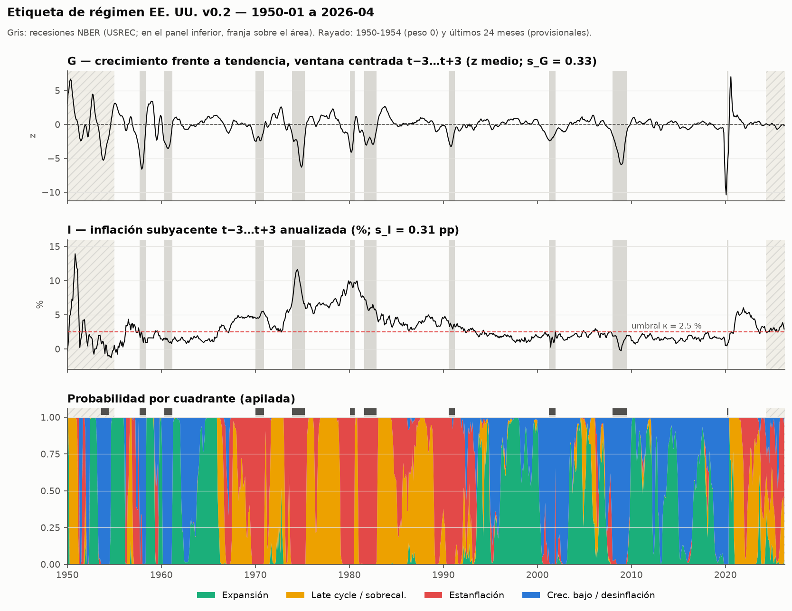

# Etiqueta de régimen EE. UU. v0.2 — comprobaciones (§8)

Generado por `src/labels/checks.py` a partir de `data/archive/labels/regime_us_v0.2.parquet` (hash de contenido `26402d5e7a6dfd58…`). Muestra 1950-01 → 2026-04 (916 meses). **Muestra puntuable: 832 meses** (weight = 1 y no provisional: fuera 1950-1954 y los 24 últimos); sin frontera: 771.

Las comprobaciones sirven para detectar errores de cálculo, **no para ajustar parámetros**. Los cambios de la v0.2 (ventanas centradas, nombre del cuadrante G↓I↓, pesos) los aprobó el usuario como corrección de la definición, antes de calcular estas comprobaciones; los umbrales de la §8 no cambian.

## 1. Escalas estimadas con ALFRED

Error de revisión = valor del eje en t con la **primera publicación** − valor con la **última vintage**. Con ventanas centradas, la "primera publicación" de G(t) es la primera vintage que contiene t+4 (último nivel que necesita la media de 3 m en t+3) y la de I(t), la primera que contiene t+3; la serie se reconstruye tal como estaba en esa vintage y se le aplica la misma transformación que al eje. Esa vintage debe salir ≤ 75 días tras el fin del mes y no puede ser el inicio del archivo ALFRED. Solo fechas maduras (≤ 2024-04). s = MAD × 1,4826; suelo 0,25; estable si n ≥ 60 y la MAD de cada mitad está entre ½ y 2 veces la total.

| serie / unidad | origen vintages | n | desde → hasta | sesgo medio | s | 1.ª mitad | 2.ª mitad | estable |
|---|---|---|---|---|---|---|---|---|
| I_PCEPILFE | warehouse | 289 | 2000-04 → 2024-04 | -0.16 | 0.305 | 0.346 | 0.289 | sí |
| I_CPILFESL | warehouse | 332 | 1996-09 → 2024-04 | 0.00 | 0.178 | 0.164 | 0.257 | sí |
| G_z_INDPRO | warehouse | 892 | 1950-01 → 2024-04 | -0.04 | 0.614 | 0.695 | 0.543 | sí |
| G_z_PAYEMS | warehouse | 831 | 1955-01 → 2024-04 | -0.07 | 0.344 | 0.549 | 0.243 | sí |
| G_z_W875RX1 | labels/raw/alfred | 172 | 2010-01 → 2024-04 | -0.42 | 0.730 | 0.820 | 0.620 | sí |
| G_z_CMRMTSPL | labels/raw/alfred | 132 | 2012-12 → 2024-04 | 0.23 | 0.449 | 0.301 | 0.548 | sí |
| G_composite | — | 132 | 2012-12 → 2024-04 | 0.05 | 0.333 | 0.263 | 0.447 | sí |
| G_composite_INDPRO_PAYEMS | — | 831 | 1955-01 → 2024-04 | -0.04 | 0.399 | 0.521 | 0.301 | sí |

- **s_G = 0.333** (alfred): error del G compuesto con los cuatro indicadores (INDPRO + PAYEMS + W875RX1 + CMRMTSPL), en los 132 meses en que los cuatro tienen primera publicación (2012-12 → 2024-04). Contraste: INDPRO + PAYEMS en 1955-2024 da 0.399 (era la escala de la v0.1).
- Vintages de W875RX1 y CMRMTSPL: ALFRED las tiene (desde 2010-05 y 2013-06). Se descargan con `python -m src.labels.regime_us --fetch-vintages` a `data/archive/labels/raw/alfred/` (sin tocar `src/ingest` ni el warehouse).
- **s_I = 0.305 pp** (alfred): PCE subyacente. El IPC subyacente da 0.18 pp (solo revisa factores estacionales); contraste.

## 2. Comprobaciones

Muestra puntuable completa y, aparte, sin meses de frontera. El ✅/❌ oficial es el de la muestra completa.

| criterio | esperado | obtenido | | sin frontera | |
|---|---|---|---|---|---|
| Meses NBER de recesión con P(G alto) < 0,5 | ≥ 85 % | 100.0% (n=103) | ✅ | 100.0% (n=103) | ✅ |
| Correlación G con CFNAI-MA3 contemporáneo (1967+) | > 0,7 | 0.74 (n=684) | ✅ | 0.74 (n=631) | ✅ |
| Correlación G con CFNAI en la ventana de G (t−3…t+4) | > 0,7 | 0.95 (n=683) | ✅ | 0.95 (n=630) | ✅ |
| Correlación G con la brecha (GDPC1 vs GDPPOT), en cambios | > 0,6 | 0.88 (G vs Δ brecha T−1→T+1; n=277) | ✅ | 0.88 (G vs Δ brecha T−1→T+1; n=257) | ✅ |
| Episodio 1973-75 | estanflación dominante | 75% en Estanflación (n=36) | ✅ | 75% en Estanflación (n=36) | ✅ |
| Episodio 1979-80 | estanflación dominante | 75% en Estanflación (n=24) | ✅ | 75% en Estanflación (n=24) | ✅ |
| Episodio 2021-T2 a 2022 | sobrecalentamiento / estanflación | 100% en Late cycle / sobrecal./Estanflación (n=21) | ✅ | 100% en Late cycle / sobrecal./Estanflación (n=19) | ✅ |
| Episodio 1995-99 | expansión | 78% en Expansión (n=60) | ✅ | 78% en Expansión (n=59) | ✅ |
| Episodio 2008-09 | crecimiento bajo / desinflación | 96% en Crec. bajo / desinflación (n=24) | ✅ | 96% en Crec. bajo / desinflación (n=24) | ✅ |
| Episodio 2020-T2 | crecimiento bajo / desinflación | 67% en Crec. bajo / desinflación (n=3) | ✅ | 67% en Crec. bajo / desinflación (n=3) | ✅ |
| Distribución por cuadrante | ninguno < 10 % | mín. 23% (Crec. bajo / desinflación) | ✅ | mín. 24% (Crec. bajo / desinflación) | ✅ |
| Duración media de los regímenes duros | ≥ 6 meses | 9.1 m (91 tramos; mediana 6) | ✅ | 9.6 m (80 tramos; mediana 6) | ✅ |
| Correlación G-I | se informa; revisar si |ρ| > 0,3 | -0.12 | ✅ | -0.12 | ✅ |

**Acierto esperado de la etiqueta dura frente a la blanda** (media de la probabilidad máxima, es decir, la probabilidad de que el cuadrante duro coincida con el "verdadero"): 84.2% en la muestra puntuable; 86.9% sin frontera; 49.7% en los 7.3% de meses frontera.

**Brecha de producción.** Con la ventana centrada, G en el mes central del trimestre T compara la media de T+1 con la de T−1, así que se compara con gap(T+1) − gap(T−1). GDPPOT (CBO) sale de la vista `forecasts`, solo hasta el último GDPC1.

**CFNAI (diagnóstico).** Correlación de G(t) con CFNAI-MA3(t+k): k=-2: 0.40, k=-1: 0.60, k=+0: 0.74, k=+1: 0.80, k=+2: 0.81, k=+3: 0.75. Sin 2020-2021: 0.84. Por periodos (MA3 contemporáneo / ventana de G): 1967-1983 0.84 / 0.97; 1984-2007 0.86 / 0.96; 2008-2019 0.90 / 0.98; 2020-2021 0.58 / 1.00; 2022-2024 -0.46 / -0.55. CFNAI-MA3(t+1) cubre t−1…t+1, centrado en t como G; el máximo está en k = +1/+2, como se espera (en la v0.1 estaba en k = −2/−3).
En 2022-2024 (hasta el último mes no provisional) la correlación es negativa también con la ventana de G (-0.55). Es un resultado real, ya visto en la v0.1: los dos indicadores están cerca de cero (poca señal), G compara con una tendencia local de 10 años (truncada al final) y CFNAI con una tendencia fija, y la debilidad de 2023 fue de manufactura (pesa mucho en CFNAI) mientras empleo y renta real crecían por encima de su tendencia. Esos meses están en la ventana truncada y se recalcularán.

**Correlación G-I** (1984+: 0.25).

## 3. Episodios

| episodio | meses | Expansión | Late cycle / sobrecal. | Estanflación | Crec. bajo / desinflación | prob. media dominante |
|---|---|---|---|---|---|---|
| 1973-75 | 36 | 0 | 9 | 27 | 0 | Estanflación (0.74) |
| 1979-80 | 24 | 0 | 6 | 18 | 0 | Estanflación (0.78) |
| 2021-T2 a 2022 | 21 | 0 | 15 | 6 | 0 | Late cycle / sobrecal. (0.65) |
| 1995-99 | 60 | 47 | 0 | 0 | 13 | Expansión (0.68) |
| 2008-09 | 24 | 1 | 0 | 0 | 23 | Crec. bajo / desinflación (0.93) |
| 2020-T2 | 3 | 1 | 0 | 0 | 2 | Crec. bajo / desinflación (0.67) |

## 4. Distribución por cuadrante

| cuadrante | % meses (dura) | % sin frontera | prob. media (blanda) | tramos | duración media | mediana | máx. |
|---|---|---|---|---|---|---|---|
| Expansión | 29.2% | 28.9% | 27.0% | 21 | 11.6 | 8 | 50 |
| Late cycle / sobrecal. | 24.2% | 23.7% | 23.7% | 23 | 8.7 | 6 | 32 |
| Estanflación | 23.4% | 23.7% | 25.0% | 25 | 7.8 | 4 | 38 |
| Crec. bajo / desinflación | 23.2% | 23.6% | 24.2% | 22 | 8.8 | 5 | 25 |

### Por década (% de meses, etiqueta dura; 1950s = solo 1955-1959)

| década | meses | Expansión | Late cycle / sobrecal. | Estanflación | Crec. bajo / desinflación |
|---|---|---|---|---|---|
| 1950s | 60 | 47% | 10% | 18% | 25% |
| 1960s | 120 | 32% | 20% | 18% | 29% |
| 1970s | 120 | 1% | 52% | 47% | 0% |
| 1980s | 120 | 0% | 57% | 43% | 0% |
| 1990s | 120 | 52% | 3% | 32% | 13% |
| 2000s | 120 | 32% | 7% | 3% | 58% |
| 2010s | 120 | 57% | 0% | 0% | 43% |
| 2020s | 52 | 13% | 54% | 23% | 10% |

## 5. Matriz de transición (etiqueta dura, muestra puntuable)

Recuentos (fila = mes anterior, columna = mes siguiente) y probabilidad por fila.

| desde \ hacia | Expansión | Late cycle / sobrecal. | Estanflación | Crec. bajo / desinflación |
|---|---|---|---|---|
| Expansión | 222 (91%) | 8 (3%) | 0 (0%) | 13 (5%) |
| Late cycle / sobrecal. | 5 (2%) | 178 (89%) | 18 (9%) | 0 (0%) |
| Estanflación | 0 (0%) | 15 (8%) | 170 (88%) | 9 (5%) |
| Crec. bajo / desinflación | 15 (8%) | 0 (0%) | 7 (4%) | 171 (89%) |

## 6. Comparación v0.1 → v0.2

Meses comparados: 856 (fechas comunes con weight = 1, 1955-01 → 2026-04). **Cambian de cuadrante 244 meses (28.5%).**

- Desfase confirmado: G v0.2(t) correlaciona al máximo con G v0.1(t+4) (1.000; contemporánea 0.54) e I v0.2(t) con I v0.1(t+3) (1.000; contemporánea 0.91). La v0.1 etiquetaba el mes t con el crecimiento de ~t−4 y la inflación de ~t−3: además de llegar tarde, los dos ejes estaban desalineados un mes entre sí.
- La v0.2 termina en 2026-04 (la v0.1 llegaba a 2026-08): ver §8.

| v0.1 \ v0.2 | Expansión | Late cycle / sobrecal. | Estanflación | Crec. bajo / desinflación |
|---|---|---|---|---|
| Expansión | 183 | 13 | 9 | 40 |
| Late cycle / sobrecal. | 8 | 144 | 53 | 2 |
| Estanflación | 6 | 45 | 145 | 12 |
| Crec. bajo / desinflación | 47 | 2 | 7 | 140 |

Cambios por episodio (meses cambiados / meses de la ventana):

| episodio | cambian | meses |
|---|---|---|
| 1973-75 | 11 | 36 |
| 1979-80 | 8 | 24 |
| 2021-T2 a 2022 | 8 | 21 |
| 1995-99 | 8 | 60 |
| 2008-09 | 2 | 24 |
| 2020-T2 | 1 | 3 |
| recesión 1957-09…1958-04 (desde 6 m antes) | 7 | 14 |
| recesión 1960-05…1961-02 (desde 6 m antes) | 7 | 16 |
| recesión 1970-01…1970-11 (desde 6 m antes) | 0 | 17 |
| recesión 1973-12…1975-03 (desde 6 m antes) | 3 | 22 |
| recesión 1980-02…1980-07 (desde 6 m antes) | 0 | 12 |
| recesión 1981-08…1982-11 (desde 6 m antes) | 3 | 22 |
| recesión 1990-08…1991-03 (desde 6 m antes) | 0 | 14 |
| recesión 2001-04…2001-11 (desde 6 m antes) | 0 | 14 |
| recesión 2008-01…2009-06 (desde 6 m antes) | 3 | 24 |
| recesión 2020-03…2020-04 (desde 6 m antes) | 0 | 8 |

Bloques más largos de meses consecutivos que cambian:

| desde | hasta | meses | cambio principal |
|---|---|---|---|
| 1959-05 | 1960-01 | 9 | Expansión → Estanflación |
| 1956-03 | 1956-10 | 8 | Estanflación → Late cycle / sobrecal. |
| 1957-01 | 1957-08 | 8 | Late cycle / sobrecal. → Estanflación |
| 1971-05 | 1971-11 | 7 | Estanflación → Late cycle / sobrecal. |
| 2006-05 | 2006-11 | 7 | Late cycle / sobrecal. → Estanflación |
| 2012-04 | 2012-10 | 7 | Expansión → Crec. bajo / desinflación |
| 1993-07 | 1993-11 | 5 | Estanflación → Expansión |
| 2003-06 | 2003-10 | 5 | Crec. bajo / desinflación → Expansión |
| 1958-06 | 1958-09 | 4 | Crec. bajo / desinflación → Expansión |
| 1960-03 | 1960-06 | 4 | Expansión → Crec. bajo / desinflación |
| 1961-04 | 1961-07 | 4 | Crec. bajo / desinflación → Expansión |
| 1962-03 | 1962-06 | 4 | Expansión → Crec. bajo / desinflación |

Los 244 meses cambiados forman 78 bloques; el 77% de los meses cambiados está en bloques de 1-4 meses, en los giros: la v0.2 adelanta los cambios de régimen unos 3-4 meses respecto a la v0.1, así que en cada giro cambian los meses entre el giro real y el giro que veía la v0.1.

## 7. Últimos 6 meses (provisionales)

| mes | G | I | Expansión | Late cycle / sobrecal. | Estanflación | Crec. bajo / desinflación | etiqueta dura | frontera |
|---|---|---|---|---|---|---|---|---|
| 2025-11 | -0.31 | 3.27 | 0.00 | 0.17 | 0.82 | 0.00 | Estanflación | no |
| 2025-12 | -0.16 | 3.32 | 0.00 | 0.31 | 0.68 | 0.00 | Estanflación | no |
| 2026-01 | -0.07 | 3.54 | 0.00 | 0.42 | 0.58 | 0.00 | Estanflación | no |
| 2026-02 | -0.05 | 3.86 | 0.00 | 0.44 | 0.56 | 0.00 | Estanflación | no |
| 2026-03 | -0.03 | 3.48 | 0.00 | 0.46 | 0.54 | 0.00 | Estanflación | sí |
| 2026-04 | -0.17 | 2.93 | 0.03 | 0.28 | 0.63 | 0.06 | Estanflación | no |

## 8. Notas de implementación

- **Final de la muestra.** Con ventanas centradas, G(t) necesita niveles hasta t+4 e I(t) hasta t+3. Último dato: INDPRO 2026-08, PAYEMS 2026-09, W875RX1 2026-08, CMRMTSPL 2026-07, PCEPILFE 2026-08. G con ≥ 2 indicadores llega a 2026-04 (2026-05 solo tendría PAYEMS), así que la etiqueta termina en 2026-04, unos 4 meses antes que la v0.1. Los meses posteriores no tienen etiqueta hasta que se publiquen sus datos t+4: la etiqueta del mes t está disponible ~5 meses después.
- **Meses provisionales.** Siguen siendo los 24 últimos de la etiqueta. Con la ventana centrada, los últimos meses dependen de datos aún más recientes (t+3/t+4, recién publicados y sin revisar), así que los 24 meses cubren hasta ~28 meses de datos. La tendencia (±60 m) sigue truncada en los últimos 60 meses.
- **Inicio.** G(1950-01) usa niveles desde 1949-09 e I(1950-01) desde 1949-10, así que el inicio no cambia. PCE subyacente centrado desde 1959-04 e IPC subyacente − 0,4 desde 1957-04 (antes 1959-07 / 1957-07). Diferencia media IPC − PCE subyacentes (contraste del ajuste de 0,4 pp, no se cambia): 0.46 pp.
- **Pesos.** `weight` = 0 en 1950-1954 (IPC general con la guerra de Corea, tendencia truncada) y 1 en el resto. Esos meses no puntúan (ni en el backtest ni en estas comprobaciones), pero se conservan en el fichero.
- **Nombre.** El cuadrante G↓ I↓ pasa de `slowdown` ("desaceleración / recesión") a `low_growth_disinfl` ("crecimiento bajo / desinflación"), columna `p_low_growth_disinfl`. Alias en `meta.json` (`aliases_v0_1`). La recesión es solo la capa `usrec`.
- `tendencia_truncada` sigue la ficha (primeros y últimos 60 meses); W875RX1 (1959) y CMRMTSPL (1967) también tienen la ventana truncada en sus primeros 5 años.

## 9. Comprobaciones que fallan

Ninguna.

## 10. Propuestas (para que decida el usuario; no aplicadas)

1. **Embargo del backtest.** La etiqueta de t usa datos hasta t+4 (y la tendencia, hasta t+60). En el walk-forward, el purging/embargo entre entrenamiento y prueba debe ser de al menos 4-5 meses (mejor 6), y la etiqueta de t no se conoce hasta ~t+5.
2. **Escala s_G.** La de cuatro indicadores (0.33) solo cubre 2012-2024; INDPRO + PAYEMS en 1955-2024 da 0.40. El ruido de revisión era mayor antes de ~1990. Se podría estudiar una escala por época (o la más conservadora de las dos); ahora se usa la que pide la ficha (todas las series con vintages).
3. **Meses provisionales.** Con ventana centrada, los últimos meses dependen de datos t+3/t+4 recién publicados. Valorar la alternativa de 36 meses de la §11, o medir con ALFRED cuánto cambia la etiqueta dura de un mes según su antigüedad antes de decidir.
4. **CFNAI 2022-2024.** Si se quiere un contraste del tramo final más informativo, comparar también con una tendencia fija (o la de la v1.0 congelada) cuando esos meses salgan de la ventana truncada.
