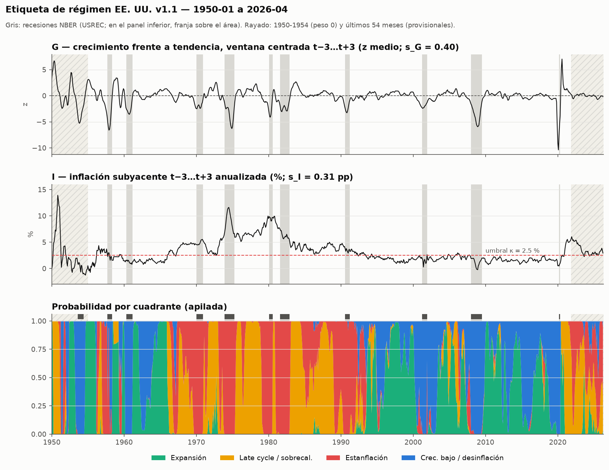

# Etiqueta de régimen EE. UU. v1.1 — comprobaciones (§8)

Generado por `src/labels/checks.py` a partir de `data/archive/labels/regime_us_v1.1.parquet` (hash de contenido `8425b403f14626a1…`). Muestra 1950-01 → 2026-04 (916 meses). **Muestra puntuable: 802 meses** (weight = 1 y no provisional: fuera 1950-1954 y los 54 últimos); sin frontera: 738.

**Versión CONGELADA.** Parámetros finales aprobados por el usuario: s_G = 0.40 y s_I = 0.31 fijas; `provisional_months` = 54 (estudio de revisión, `docs/models/label_revision_study.md`); `embargo_months` = 6; el resto como en la v0.2. Las comprobaciones sirven para detectar errores de cálculo, **no para ajustar parámetros**; los umbrales de la §8 no cambian. Código: SHA-256 `3a51c62444551cd3…`.

## 1. Escalas: valores fijos y estimaciones ALFRED de referencia

Error de revisión = valor del eje en t con la **primera publicación** − valor con la **última vintage**. Con ventanas centradas, la "primera publicación" de G(t) es la primera vintage que contiene t+4 (último nivel que necesita la media de 3 m en t+3) y la de I(t), la primera que contiene t+3; la serie se reconstruye tal como estaba en esa vintage y se le aplica la misma transformación que al eje. Esa vintage debe salir ≤ 75 días tras el fin del mes y no puede ser el inicio del archivo ALFRED. Solo fechas maduras (≤ 2024-04). s = MAD × 1,4826; suelo 0,25; estable si n ≥ 60 y la MAD de cada mitad está entre ½ y 2 veces la total.

| serie / unidad | origen vintages | n | desde → hasta | sesgo medio | s | 1.ª mitad | 2.ª mitad | estable |
|---|---|---|---|---|---|---|---|---|
| I_PCEPILFE | warehouse | 289 | 2000-04 → 2024-04 | -0.16 | 0.305 | 0.346 | 0.289 | sí |
| I_CPILFESL | warehouse | 332 | 1996-09 → 2024-04 | 0.00 | 0.178 | 0.164 | 0.257 | sí |
| G_z_INDPRO | warehouse | 892 | 1950-01 → 2024-04 | -0.04 | 0.614 | 0.695 | 0.543 | sí |
| G_z_PAYEMS | warehouse | 831 | 1955-01 → 2024-04 | -0.07 | 0.344 | 0.549 | 0.243 | sí |
| G_z_W875RX1 | labels/raw/alfred | 172 | 2010-01 → 2024-04 | -0.42 | 0.730 | 0.820 | 0.620 | sí |
| G_z_CMRMTSPL | labels/raw/alfred | 132 | 2012-12 → 2024-04 | 0.23 | 0.449 | 0.301 | 0.548 | sí |
| G_composite | — | 132 | 2012-12 → 2024-04 | 0.05 | 0.333 | 0.263 | 0.447 | sí |
| G_composite_INDPRO_PAYEMS | — | 831 | 1955-01 → 2024-04 | -0.04 | 0.399 | 0.521 | 0.301 | sí |

- **s_G = 0.40** (fija (ficha §11)): estimación con INDPRO + PAYEMS en 1955-2024 (0.399), redondeada. La de cuatro indicadores (0.333, 2012-12 → 2024-04) era la de la v0.2: cubre solo un periodo de revisiones pequeñas.
- Vintages de W875RX1 y CMRMTSPL: ALFRED las tiene (desde 2010-05 y 2013-06). Se descargan con `python -m src.labels.regime_us --fetch-vintages` a `data/archive/labels/raw/alfred/` (sin tocar `src/ingest` ni el warehouse).
- **s_I = 0.31 pp** (fija (ficha §11)): PCE subyacente, estimación 0.305. El IPC subyacente da 0.18 pp (solo revisa factores estacionales); contraste.

## 2. Comprobaciones

Muestra puntuable completa y, aparte, sin meses de frontera. El ✅/❌ oficial es el de la muestra completa.

| criterio | esperado | obtenido | | sin frontera | |
|---|---|---|---|---|---|
| Meses NBER de recesión con P(G alto) < 0,5 | ≥ 85 % | 100.0% (n=103) | ✅ | 100.0% (n=103) | ✅ |
| Correlación G con CFNAI-MA3 contemporáneo (1967+) | > 0,7 | 0.74 (n=654) | ✅ | 0.74 (n=599) | ✅ |
| Correlación G con CFNAI en la ventana de G (t−3…t+4) | > 0,7 | 0.95 (n=653) | ✅ | 0.96 (n=598) | ✅ |
| Correlación G con la brecha (GDPC1 vs GDPPOT), en cambios | > 0,6 | 0.88 (G vs Δ brecha T−1→T+1; n=267) | ✅ | 0.88 (G vs Δ brecha T−1→T+1; n=243) | ✅ |
| Episodio 1973-75 | estanflación dominante | 75% en Estanflación (n=36) | ✅ | 75% en Estanflación (n=36) | ✅ |
| Episodio 1979-80 | estanflación dominante | 75% en Estanflación (n=24) | ✅ | 75% en Estanflación (n=24) | ✅ |
| Episodio 2021-T2 a 2022 | sobrecalentamiento / estanflación | 100% en Late cycle / sobrecal./Estanflación (n=7) | ✅ | 100% en Late cycle / sobrecal./Estanflación (n=7) | ✅ |
| Episodio 1995-99 | expansión | 78% en Expansión (n=60) | ✅ | 77% en Expansión (n=57) | ✅ |
| Episodio 2008-09 | crecimiento bajo / desinflación | 96% en Crec. bajo / desinflación (n=24) | ✅ | 96% en Crec. bajo / desinflación (n=24) | ✅ |
| Episodio 2020-T2 | crecimiento bajo / desinflación | 67% en Crec. bajo / desinflación (n=3) | ✅ | 67% en Crec. bajo / desinflación (n=3) | ✅ |
| Distribución por cuadrante | ninguno < 10 % | mín. 23% (Late cycle / sobrecal.) | ✅ | mín. 22% (Late cycle / sobrecal.) | ✅ |
| Duración media de los regímenes duros | ≥ 6 meses | 9.3 m (86 tramos; mediana 6) | ✅ | 10.0 m (74 tramos; mediana 6) | ✅ |
| Correlación G-I | se informa; revisar si |ρ| > 0,3 | -0.13 | ✅ | -0.13 | ✅ |

**Acierto esperado de la etiqueta dura frente a la blanda** (media de la probabilidad máxima, es decir, la probabilidad de que el cuadrante duro coincida con el "verdadero"): 82.8% en la muestra puntuable; 85.7% sin frontera; 49.4% en los 8.0% de meses frontera.

**Brecha de producción.** Con la ventana centrada, G en el mes central del trimestre T compara la media de T+1 con la de T−1, así que se compara con gap(T+1) − gap(T−1). GDPPOT (CBO) sale de la vista `forecasts`, solo hasta el último GDPC1.

**CFNAI (diagnóstico).** Correlación de G(t) con CFNAI-MA3(t+k): k=-2: 0.40, k=-1: 0.60, k=+0: 0.74, k=+1: 0.81, k=+2: 0.81, k=+3: 0.76. Sin 2020-2021: 0.84. Por periodos (MA3 contemporáneo / ventana de G): 1967-1983 0.84 / 0.97; 1984-2007 0.86 / 0.96; 2008-2019 0.90 / 0.98; 2020-2021 0.58 / 1.00. CFNAI-MA3(t+1) cubre t−1…t+1, centrado en t como G; el máximo está en k = +1/+2, como se espera (en la v0.1 estaba en k = −2/−3).
El tramo 2022-2024 (correlación negativa en la v0.2) es ahora provisional y no puntúa; el estudio de revisión muestra que no se debe al borde, sino a un desacuerdo de composición en un tramo casi plano (`docs/models/label_revision_study.md`).

**Correlación G-I** (1984+: 0.27).

## 3. Episodios

| episodio | meses | Expansión | Late cycle / sobrecal. | Estanflación | Crec. bajo / desinflación | prob. media dominante |
|---|---|---|---|---|---|---|
| 1973-75 | 36 | 0 | 9 | 27 | 0 | Estanflación (0.73) |
| 1979-80 | 24 | 0 | 6 | 18 | 0 | Estanflación (0.78) |
| 2021-T2 a 2022 | 7 | 0 | 7 | 0 | 0 | Late cycle / sobrecal. (0.95) |
| 1995-99 | 60 | 47 | 0 | 0 | 13 | Expansión (0.67) |
| 2008-09 | 24 | 1 | 0 | 0 | 23 | Crec. bajo / desinflación (0.92) |
| 2020-T2 | 3 | 1 | 0 | 0 | 2 | Crec. bajo / desinflación (0.67) |

## 4. Distribución por cuadrante

| cuadrante | % meses (dura) | % sin frontera | prob. media (blanda) | tramos | duración media | mediana | máx. |
|---|---|---|---|---|---|---|---|
| Expansión | 30.0% | 29.5% | 27.4% | 20 | 12.1 | 9 | 50 |
| Late cycle / sobrecal. | 23.1% | 22.5% | 22.8% | 21 | 8.8 | 6 | 32 |
| Estanflación | 23.6% | 24.3% | 25.0% | 23 | 8.2 | 4 | 38 |
| Crec. bajo / desinflación | 23.3% | 23.7% | 24.8% | 22 | 8.5 | 4 | 25 |

### Por década (% de meses, etiqueta dura; 1950s = solo 1955-1959)

| década | meses | Expansión | Late cycle / sobrecal. | Estanflación | Crec. bajo / desinflación |
|---|---|---|---|---|---|
| 1950s | 60 | 47% | 10% | 28% | 15% |
| 1960s | 120 | 32% | 20% | 18% | 29% |
| 1970s | 120 | 1% | 52% | 47% | 0% |
| 1980s | 120 | 0% | 57% | 43% | 0% |
| 1990s | 120 | 52% | 3% | 32% | 13% |
| 2000s | 120 | 32% | 7% | 3% | 58% |
| 2010s | 120 | 57% | 0% | 0% | 43% |
| 2020s | 22 | 23% | 55% | 0% | 23% |

## 5. Matriz de transición (etiqueta dura, muestra puntuable)

Recuentos (fila = mes anterior, columna = mes siguiente) y probabilidad por fila.

| desde \ hacia | Expansión | Late cycle / sobrecal. | Estanflación | Crec. bajo / desinflación |
|---|---|---|---|---|
| Expansión | 221 (92%) | 7 (3%) | 0 (0%) | 13 (5%) |
| Late cycle / sobrecal. | 4 (2%) | 164 (89%) | 16 (9%) | 0 (0%) |
| Estanflación | 0 (0%) | 14 (7%) | 166 (88%) | 9 (5%) |
| Crec. bajo / desinflación | 15 (8%) | 0 (0%) | 7 (4%) | 165 (88%) |

## 6. Comparación v1.0 → v1.1

Meses comparados: 856 (fechas comunes con weight = 1, 1955-01 → 2026-04). **Cambian de cuadrante 6 meses (0.7%)**; en la muestra puntuable de la v1.1: 6 de 802.

- G no cambia (|ΔG| máx. 0.0e+00). I solo cambia en 1957-04 → 1959-03 (|ΔI| máx. 0.60 pp), los meses del empalme IPC → PCE subyacente. Meses que cambian de cuadrante: 1957-05, 1957-06, 1957-07, 1957-09, 1957-11, 1957-12. Δp medio 0.0070 (máx. 0.601); meses frontera 84 → 84.
- Provisionales: desde 2021-11 (antes desde 2021-11).

| v1.0 \ v1.1 | Expansión | Late cycle / sobrecal. | Estanflación | Crec. bajo / desinflación |
|---|---|---|---|---|
| Expansión | 244 | 0 | 0 | 0 |
| Late cycle / sobrecal. | 0 | 204 | 0 | 0 |
| Estanflación | 0 | 0 | 214 | 0 |
| Crec. bajo / desinflación | 0 | 0 | 6 | 188 |

Cambios por episodio (meses cambiados / meses de la ventana):

| episodio | cambian | meses |
|---|---|---|
| 1973-75 | 0 | 36 |
| 1979-80 | 0 | 24 |
| 2021-T2 a 2022 | 0 | 21 |
| 1995-99 | 0 | 60 |
| 2008-09 | 0 | 24 |
| 2020-T2 | 0 | 3 |
| recesión 1957-09…1958-04 (desde 6 m antes) | 6 | 14 |
| recesión 1960-05…1961-02 (desde 6 m antes) | 0 | 16 |
| recesión 1970-01…1970-11 (desde 6 m antes) | 0 | 17 |
| recesión 1973-12…1975-03 (desde 6 m antes) | 0 | 22 |
| recesión 1980-02…1980-07 (desde 6 m antes) | 0 | 12 |
| recesión 1981-08…1982-11 (desde 6 m antes) | 0 | 22 |
| recesión 1990-08…1991-03 (desde 6 m antes) | 0 | 14 |
| recesión 2001-04…2001-11 (desde 6 m antes) | 0 | 14 |
| recesión 2008-01…2009-06 (desde 6 m antes) | 0 | 24 |
| recesión 2020-03…2020-04 (desde 6 m antes) | 0 | 8 |

Bloques más largos de meses consecutivos que cambian:

| desde | hasta | meses | cambio principal |
|---|---|---|---|
| 1957-05 | 1957-07 | 3 | Crec. bajo / desinflación → Estanflación |
| 1957-11 | 1957-12 | 2 | Crec. bajo / desinflación → Estanflación |
| 1957-09 | 1957-09 | 1 | Crec. bajo / desinflación → Estanflación |

Los 6 meses cambiados forman 3 bloques; el 100% está en bloques de 1-4 meses.

## 6b. Persistencia point-in-time (referencia que hay que batir)

En la fecha de decisión t (último día hábil de t) la última etiqueta calculable es la de t − **5** (`label_lag`): G necesita niveles hasta s+4 de ≥ 2 indicadores, e INDPRO/PAYEMS de t−1 son los últimos publicados (→ s = t−5); I necesita el índice hasta s+3 y el PCE de t−2 es el último (→ s = t−5). La predicción PIT es esa etiqueta, **recalculada solo con los datos publicados en t** (cada serie truncada en t − meses de retraso), es decir, en su versión provisional. Log-loss con probabilidades recortadas a [0.0001, 1] y renormalizadas; objetivo blando = probabilidades de la etiqueta; Brier sobre los 4 cuadrantes.

| muestra | baseline | n | acierto | log-loss (blando) | log-loss (duro) | Brier |
|---|---|---|---|---|---|---|
| puntuable | PIT (t−5, datos de t) | 797 | 63.6% | 1.235 | 1.110 | 0.303 |
| puntuable | final desplazada 5 | 797 | 68.0% | 1.479 | 1.298 | 0.338 |
| puntuable | final desplazada 1 (con fuga) | 797 | 89.3% | 0.529 | 0.336 | 0.056 |
| entrenamiento | PIT (t−5, datos de t) | 595 | 62.9% | 1.227 | 1.149 | 0.319 |
| entrenamiento | final desplazada 5 | 595 | 68.7% | 1.519 | 1.375 | 0.350 |
| entrenamiento | final desplazada 1 (con fuga) | 595 | 89.4% | 0.497 | 0.322 | 0.059 |
| bloqueado | PIT (t−5, datos de t) | 202 | 65.8% | 1.259 | 0.994 | 0.256 |
| bloqueado | final desplazada 5 | 202 | 65.8% | 1.362 | 1.071 | 0.300 |
| bloqueado | final desplazada 1 (con fuga) | 202 | 89.1% | 0.620 | 0.377 | 0.045 |

5 meses (hasta 1955-05) no tienen etiqueta PIT calculable (la tendencia necesita ≥ 61 meses de ritmo desde 1950); las tres filas usan los mismos meses.

La etiqueta dura PIT coincide con la final desplazada 5 meses en el 82.2% de los meses. La persistencia con t−1 tiene fuga (usa datos hasta t+3) y **no** es una referencia válida. Periodo bloqueado: desde 2005-01, abierto.

## 7. Últimos meses maduros y provisionales

Últimos 6 meses maduros (puntuables) y últimos 6 provisionales (desde 2021-11).

| mes | estado | G | I | Expansión | Late cycle / sobrecal. | Estanflación | Crec. bajo / desinflación | etiqueta dura | frontera |
|---|---|---|---|---|---|---|---|---|---|
| 2021-05 | madura | 1.15 | 5.53 | 0.00 | 1.00 | 0.00 | 0.00 | Late cycle / sobrecal. | no |
| 2021-06 | madura | 1.02 | 5.08 | 0.00 | 0.99 | 0.01 | 0.00 | Late cycle / sobrecal. | no |
| 2021-07 | madura | 0.69 | 4.95 | 0.00 | 0.96 | 0.04 | 0.00 | Late cycle / sobrecal. | no |
| 2021-08 | madura | 0.72 | 5.03 | 0.00 | 0.96 | 0.04 | 0.00 | Late cycle / sobrecal. | no |
| 2021-09 | madura | 0.55 | 5.15 | 0.00 | 0.92 | 0.08 | 0.00 | Late cycle / sobrecal. | no |
| 2021-10 | madura | 0.36 | 5.30 | 0.00 | 0.81 | 0.19 | 0.00 | Late cycle / sobrecal. | no |
| 2025-11 | provisional | -0.31 | 3.27 | 0.00 | 0.22 | 0.78 | 0.01 | Estanflación | no |
| 2025-12 | provisional | -0.16 | 3.32 | 0.00 | 0.34 | 0.65 | 0.00 | Estanflación | no |
| 2026-01 | provisional | -0.07 | 3.54 | 0.00 | 0.43 | 0.57 | 0.00 | Estanflación | no |
| 2026-02 | provisional | -0.05 | 3.86 | 0.00 | 0.45 | 0.55 | 0.00 | Estanflación | sí |
| 2026-03 | provisional | -0.03 | 3.48 | 0.00 | 0.47 | 0.53 | 0.00 | Estanflación | sí |
| 2026-04 | provisional | -0.17 | 2.93 | 0.03 | 0.31 | 0.60 | 0.06 | Estanflación | no |

## 8. Notas de implementación

- **Final de la muestra.** Con ventanas centradas, G(t) necesita niveles hasta t+4 e I(t) hasta t+3. Último dato: INDPRO 2026-08, PAYEMS 2026-09, W875RX1 2026-08, CMRMTSPL 2026-07, PCEPILFE 2026-08. G con ≥ 2 indicadores llega a 2026-04 (2026-05 solo tendría PAYEMS), así que la etiqueta termina en 2026-04, unos 4 meses antes que la v0.1. Los meses posteriores no tienen etiqueta hasta que se publiquen sus datos t+4: la etiqueta del mes t está disponible ~5 meses después.
- **Meses provisionales.** Los 54 últimos de la etiqueta, fijados con la regla declarada en el estudio de revisión (concordancia ≥ 95 % y Δp medio ≤ 0,05 de forma sostenida; k* = 55 meses desde el corte de datos, 51 desde el último mes de la etiqueta, redondeado a 54). La tendencia (±60 m) sigue truncada en los últimos 60 meses.
- **Uso.** Los meses con `provisional = true` o `weight = 0` no puntúan ni entrenan. Embargo del backtest: 6 meses (la etiqueta de t usa datos hasta t+4; la tendencia, hasta t+60). Columnas prohibidas como variables: `meta.json → forbidden_features` (`assert_no_forbidden`).
- **Entradas congeladas.** La etiqueta oficial se reconstruye solo desde `regime_us_v1.1_inputs.parquet` (SHA-256 del fichero `9cc855f86c6375e7…`, del contenido `7317d42bbfd9de74…`, 83865 filas) con `--from-snapshot`.
- **Empalme IPC → PCE subyacente (v1.1).** 1957-04 → 1959-03 usan el IPC subyacente más un ajuste medido con una regla fija: la media de (PCE − IPC) subyacentes, en unidades de I, en los 24 primeros meses en que coexisten (1959-04 → 1961-03): **+0.204 pp** (la v1.0 restaba 0,4 pp, la diferencia media de toda la muestra, -0.46 pp en signo PCE − IPC, que no representa el empalme).
- **Pesos.** `weight` = 0 en 1950-1954 (IPC general con la guerra de Corea, tendencia truncada) y 1 en el resto. Esos meses no puntúan (ni en el backtest ni en estas comprobaciones), pero se conservan en el fichero.
- **Nombre.** El cuadrante G↓ I↓ pasa de `slowdown` ("desaceleración / recesión") a `low_growth_disinfl` ("crecimiento bajo / desinflación"), columna `p_low_growth_disinfl`. Alias en `meta.json` (`aliases_v0_1`). La recesión es solo la capa `usrec`.
- `tendencia_truncada` sigue la ficha (primeros y últimos 60 meses); W875RX1 (1959) y CMRMTSPL (1967) también tienen la ventana truncada en sus primeros 5 años.

## 9. Comprobaciones que fallan

Ninguna.

## 10. Propuestas (para que decida el usuario; no aplicadas)

1. **Regla del empalme.** Con 24 meses sale +0.20 pp; el Validador midió ≈ +0,06 pp (PCE − IPC) en 1959-1964. La diferencia es de ventana; la regla fijada (24 meses) se mantiene. Con cualquiera de las dos solo cambian meses de 1957.
2. Las recomendaciones M5 del Validador (contrastes del eje I, especificidad de recesiones, tabla de giros) siguen pendientes para una versión futura de la §8.
