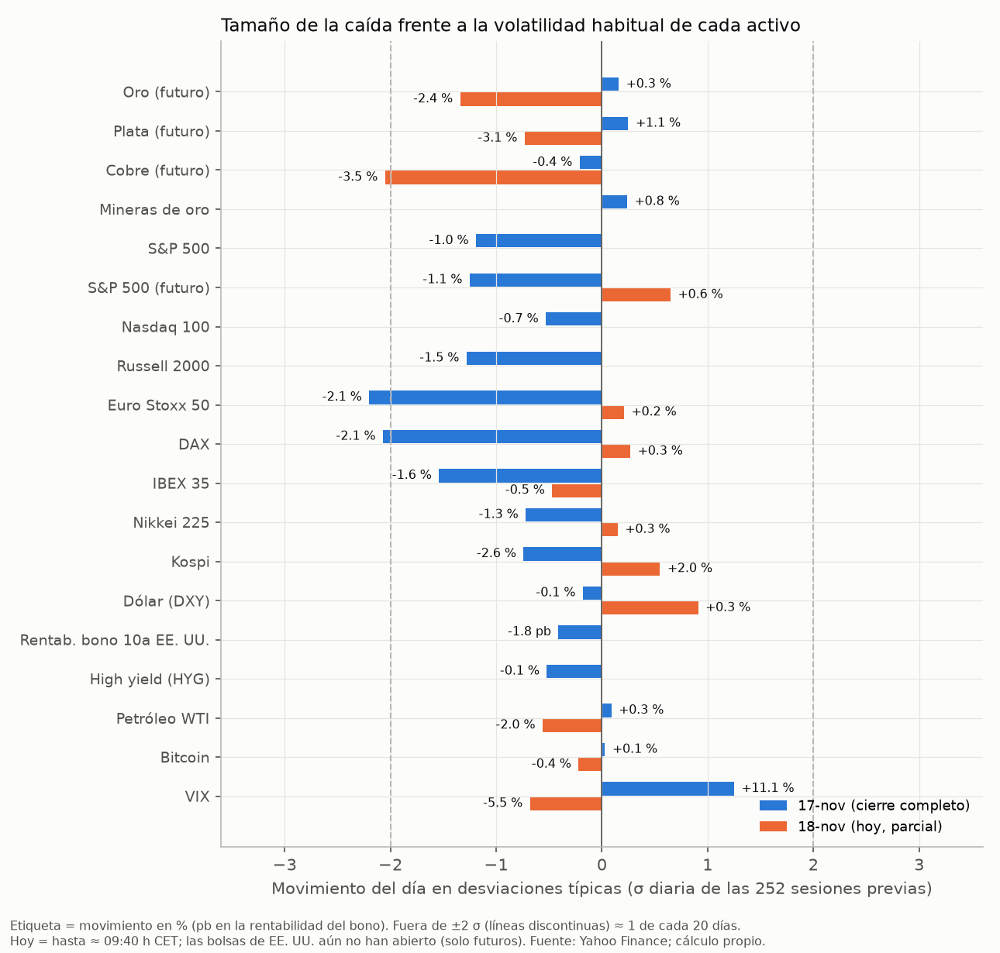
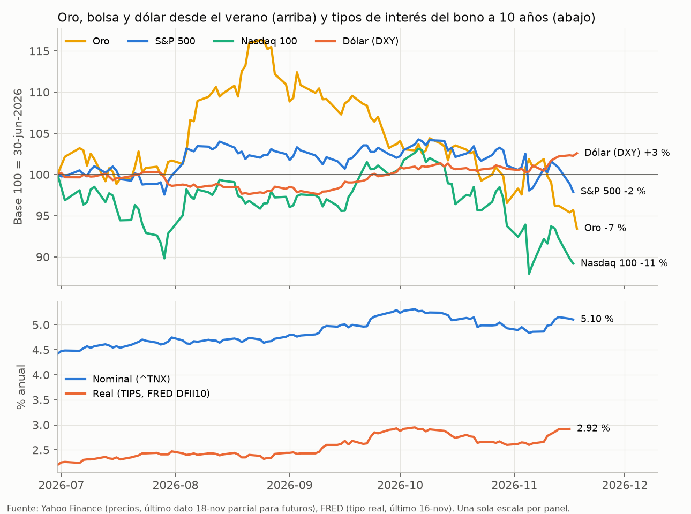
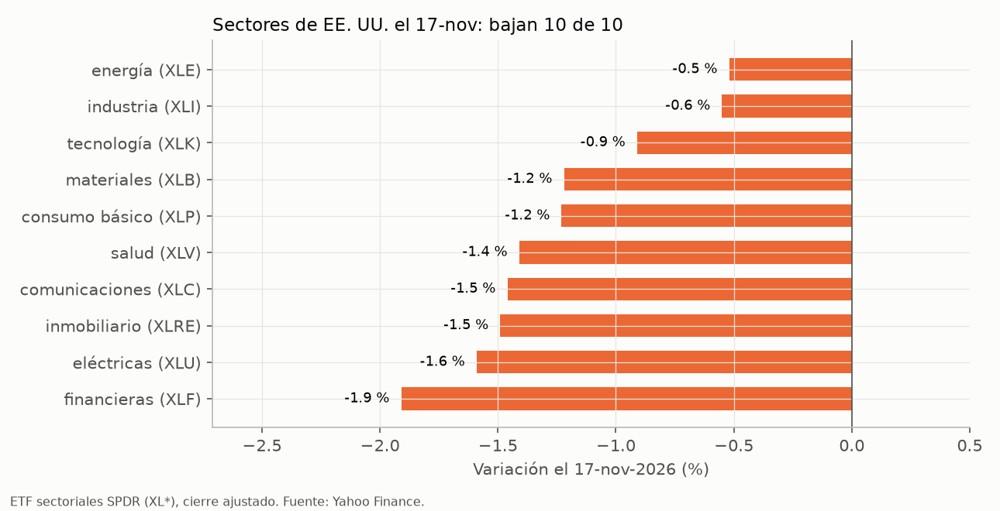
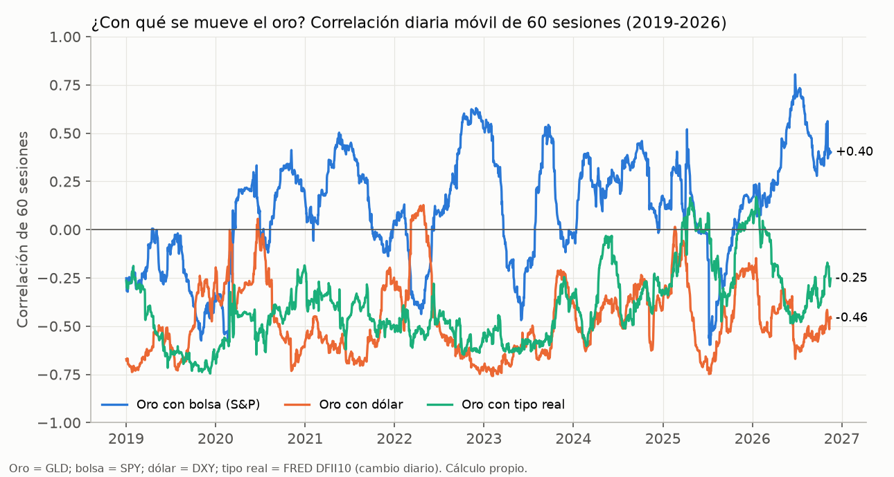
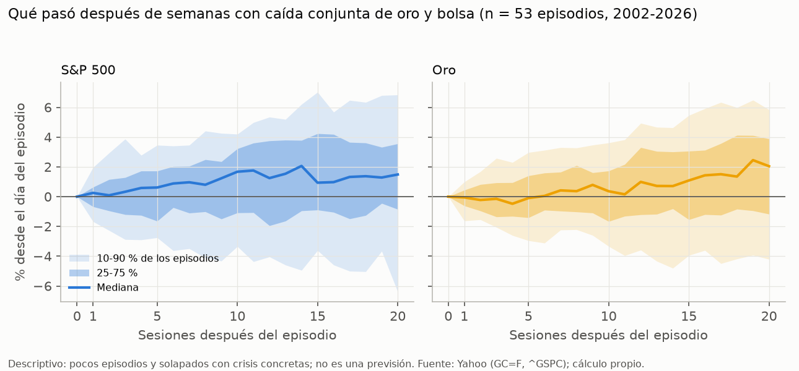

# Caída del oro y de las bolsas (18-nov-2026): qué pasa y qué dicen nuestros modelos

> [!summary] En 5 líneas
> 1. **Qué pasa:** no es un desplome de un solo día. Es **una semana mala para las dos cosas a la vez**. La bolsa de EE. UU. bajó −1,9 % el lunes y −1,0 % el martes; Europa cayó −2,1 % el martes. Hoy de madrugada el oro cae **−2,4 %**: está en su nivel más bajo desde sept-2025 y un **−29 %** por debajo de su máximo de enero. Al mismo tiempo, el dólar está en su máximo desde abr-2025 y el tipo real a 10 años en el más alto desde 2003 (2,92 %).
> 2. **Tamaño:** grande para lo habitual, pero **no extremo frente a la volatilidad actual**. El oro cae −1,3 σ (un día así sale 1 de cada 40 sesiones desde 2000, pero el oro está muy agitado este año). El S&P cae −1,2 σ y el Euro Stoxx −2,2 σ. Bajan los 10 sectores de EE. UU. El crédito no se ha movido (HY 3,3 pp, semáforo **verde**) y los futuros del S&P suben hoy +0,6 % tras los resultados de Nvidia.
> 3. **Lectura:** se parece más a «**tipos y dólar al alza + dudas sobre la IA**» que a un pánico generalizado. El oro va estos meses de la mano de la bolsa (correlación +0,40; lo normal es +0,08) y los bonos no protegen a la bolsa. Las dos cosas encajan con un mercado que descuenta subidas de tipos de la Fed.
> 4. **Nuestros modelos:** un día no cambia el régimen («Goldilocks» mensual, que va por detrás de lo que descuenta el mercado). El motor INT-11 ya daba P(bolsa real ≤ −20 % a 12 m) = 9 % y mediana real del oro −3 %: lo de hoy cabe dentro de lo que contemplaba (noviembre va por el percentil ≈ 19 de su aproximación mensual). **Lo único que cambiaría algo es B1′** (ensayo): su volatilidad prevista ya está en 19,9 % desde el 5-nov, por encima de su umbral (16,7 %), y si noviembre cerrara hoy bajaría la bolsa del 70 % al ≈ 59 %. B1 no cambia (11,0 % frente a 17,0 %).
> 5. **Qué no sabemos:** si esto sigue. En los 53 episodios parecidos desde 2002, lo que pasó 20 sesiones después fue igual de disperso que un día cualquiera (S&P entre −14 % y +15 %). Quedan las actas de la Fed (hoy a las 20:00 CET) y la salida a bolsa de Anthropic (jueves). No es asesoramiento.

**Cómo leer este informe:** «σ» (desviación típica) es el tamaño normal de un movimiento diario de ese activo en el último año. −2 σ ocurre más o menos 1 de cada 20 días. Todo es **descriptivo**: nada de esto se ha validado como señal para comprar o vender.

---

## 1. Qué ha pasado (datos)

**Horarios.** «Hoy» (18-nov) son las sesiones de Asia y Europa y los futuros, hasta las 09:42 h CET. La bolsa de EE. UU. aún no ha abierto, así que de EE. UU. el último cierre completo es el del **17-nov**. El oro se negocia casi 24 h, y su caída de −2,4 % es de esta madrugada.

| activo | 17-nov | en σ | percentil histórico del día | 18-nov (parcial) | en σ | 5 sesiones | desde máx. 52 sem. | vol. 1 año |
|---|---|---|---|---|---|---|---|---|
| Oro (futuro GC=F) | +0,3 % | +0,2 | 61 | **−2,4 %** | **−1,3** | **p2,5** | −5,7 % | −29 % | 28 % |
| Plata (futuro) | +1,1 % | +0,3 | 75 | −3,1 % | −0,7 | p5 | −11,7 % | −60 % | 69 % |
| Cobre (futuro) | −0,4 % | −0,2 | 37 | −3,5 % | −2,1 | p2 | −8,1 % | −15 % | 28 % |
| Mineras de oro (GDX) | +0,8 % | +0,2 | 65 | — | | | −8,0 % | −31 % | 52 % |
| S&P 500 | **−1,0 %** | −1,2 | p11 | futuro +0,6 % | +0,7 | | −2,4 % | −6,1 % | 14 % |
| Nasdaq 100 | −0,7 % | −0,5 | p24 | futuro +1,0 % | +0,7 | | −2,7 % | −13,5 % | 22 % |
| Russell 2000 | −1,5 % | −1,3 | p10 | futuro 0,0 % | | | −4,2 % | −11,9 % | 19 % |
| Euro Stoxx 50 | **−2,1 %** | **−2,2** | p5 | +0,2 % | +0,2 | | −2,6 % | −5,0 % | 16 % |
| DAX | −2,1 % | −2,1 | p5 | +0,3 % | | | −2,1 % | −2,4 % | 16 % |
| IBEX 35 | −1,6 % | −1,5 | p9 | −0,5 % | −0,5 | | −2,5 % | −3,4 % | 17 % |
| FTSE 100 | −1,8 % | −2,4 | p4 | −0,4 % | | | −1,7 % | −2,4 % | 12 % |
| Nikkei 225 | −1,3 % | −0,7 | p11 | +0,3 % | | | −3,6 % | −18,4 % | 30 % |
| Kospi | −2,6 % | −0,7 | p5 | +2,0 % | +0,6 | | −5,7 % | −44 % | 57 % |
| Hang Seng | −1,0 % | −0,9 | p18 | −0,9 % | −0,8 | | −4,2 % | −16,7 % | 19 % |
| VIX | 25,5 (+11 %) | +1,3 | p94 | 24,1 | | | | | |
| Dólar (DXY) | −0,1 % | −0,2 | | +0,3 % | +0,9 | | +0,9 % | en máximo de 52 sem. | 5 % |
| EUR/USD | −0,2 % | | | −0,3 % | | | −1,8 % | 1,097 | |
| Rentab. bono 10a EE. UU. | −1,8 pb → 5,10 % | −0,4 | | | | | **+12 pb** | (máx. 2026: 5,31 % el 5-oct) | |
| Tipo real 10a (TIPS, FRED) | 2,92 % (16-nov) | | | | | | +18 pb en 20 sesiones | **el más alto desde 2003** | |
| High yield (HYG) | −0,1 % | −0,5 | | | | | −0,7 % | −2,7 % | 4 % |
| Petróleo WTI | +0,3 % | | | −2,0 % | −0,6 | | −2,6 % | −25 % | 58 % |
| Bitcoin | +0,1 % | | | −0,4 % | | | −5,3 % | −33 % | 32 % |

*σ = desviación típica diaria de las 252 sesiones previas. Percentil histórico = qué parte de todos los días desde que hay datos (oro desde 2000, S&P desde 1927) tuvo un movimiento igual o peor. Fuente: Yahoo Finance (uso personal); tipo real: FRED DFII10. Datos en bruto fuera de git (`~/financial_archive/mercados/intradia/2026-11-18/`).*

**Lo que dicen los números:**
- **La caída del oro de hoy es grande en %, pero normal para lo nervioso que está el oro este año.** Un −2,4 % es el percentil 2,5 de todos los días desde 2000, pero el oro tiene ahora una volatilidad del 28 % anual (casi el doble de su media histórica). En su propia escala de este año es −1,3 σ. Lo importante es la **tendencia**: −9 % en un mes, −13 % en el año y −29 % desde el máximo de cierre de enero (5 318 $). La plata va peor (−60 % desde su máximo).
- **La bolsa lleva tres días bajando**, pero ningún día ha sido extremo en EE. UU. (−1,2 σ el martes). En Europa el martes sí fue fuerte (−2,2 σ en Euro Stoxx, −2,4 σ en FTSE), en parte porque recogía la caída de Wall Street del lunes por la tarde. El S&P está un 6 % por debajo de su máximo (6-oct) y el Nasdaq 100 un 13,5 %.
- **Hoy el mercado de acciones respira:** futuros del S&P +0,6 %, del Nasdaq +1,0 %, Kospi +2,0 %, VIX −5,5 %. El oro, la plata, el cobre y el petróleo siguen bajando, y el dólar sube.

### ¿Generalizada o concentrada?

- **El 17-nov fue generalizado dentro de la bolsa:** bajaron los 10 sectores de EE. UU., y los «defensivos» (eléctricas −1,6 %, inmobiliario −1,5 %, consumo básico −1,2 %, salud −1,4 %) cayeron igual o más que la tecnología (−0,9 %). Cuando los defensivos que dependen de los tipos (eléctricas, inmobiliario) bajan con todo lo demás, suelen ser los **tipos**, y no el miedo a una recesión, los que empujan.
- **En las últimas 5 sesiones sí hay concentración:** materiales −3,8 %, tecnología −3,3 %, industria −2,4 %. La energía sube +1,9 % y el consumo básico +0,5 %. Es el patrón de «tecnología/IA a la baja».
- **Por regiones:** el martes cayó todo (EE. UU., Europa, Japón, Corea, Hong Kong). Hoy no: Asia y Europa están planas o al alza.
- **Volumen** (17-nov, log-volumen frente a las 60 sesiones previas; `src/report/alertas.py` no está en esta rama y se hizo el cálculo equivalente): **alto pero no extremo**. SPY 1,8× su mediana (z = 1,7), tecnología XLK 2,2× (z = 1,8), financieras 1,7×, TIP 1,8× (z = 2,1, el único ≥ 2). **El ETF del oro (GLD) negoció 0,9× lo normal** el 17-nov: no hubo ventas masivas del ETF ese día (la caída fuerte del oro es posterior).

### ¿Qué tipo de caída es? Correlaciones

| par (rendimientos diarios) | últimas 60 sesiones | últimas 20 | mediana 2007-2026 | percentil de hoy |
|---|---|---|---|---|
| Oro – bolsa (GLD–SPY) | **+0,40** | +0,35 | +0,08 | 85 |
| Oro – dólar | −0,46 | −0,38 | −0,50 | 58 (normal) |
| Oro – tipo real 10a | −0,25 | −0,05 | −0,33 | 63 (algo más débil de lo normal) |
| Bolsa – rentab. 10a | +0,07 | +0,31 | +0,34 | 24 |
| Bolsa – bonos largos (SPY–TLT) | **+0,08** | −0,09 | −0,33 | 83 |

- **¿Cae el oro porque suben los tipos reales y el dólar?** En parte. La dirección encaja: el tipo real sube 18 pb en un mes hasta el máximo desde 2003, y el dólar está en máximos de 52 semanas. Pero el tamaño no cuadra. Con la relación histórica (regresión 2007-2026: el oro baja ≈ 0,04 % por cada pb de subida del tipo real y ≈ 0,9 % por cada 1 % que sube el dólar), los tipos reales y el dólar explican solo **una parte pequeña** de las caídas recientes del oro (10-nov: −2,7 % observado frente a −1,0 % «explicado»; 12-nov: −2,9 % frente a −0,5 %). Incluso históricamente explican solo un 20 % de la variación diaria del oro. **El resto no lo sabemos**: puede ser venta para cubrir pérdidas en otros activos, la salida de quienes compraron por la tendencia tras un año de subidas enormes, o ventas de bancos centrales. Nada de eso lo podemos comprobar con nuestros datos.
- **¿«Risk-off» general con todo a la baja?** No del todo. En un pánico típico el oro y los bonos suben y el crédito se tensa. Aquí el oro baja, los bonos no protegen (la correlación bolsa-bonos es positiva, +0,08, cuando lo normal es −0,33) y **el crédito apenas se mueve**. Es más bien un **«todo pierde valor porque suben los tipos y el dólar»**, típico de épocas con inflación y bancos centrales subiendo tipos.
- **¿Rotación?** Hay algo: sale dinero de tecnología/IA y de materiales, entra algo en energía y consumo básico (5 sesiones). Pero el 17-nov bajó todo.
- **El oro se comporta como un activo de riesgo** este año (correlación con la bolsa en el percentil 85, llegó a +0,8 en verano). Por eso no está protegiendo la cartera en esta caída.

### Noticias y calendario (fuentes públicas; no verificadas una a una)

Lo que dice la prensa (resumido; ver fuentes al final). **No hemos comprobado estas causas con datos propios**:
- **Fed:** el mercado descuenta casi seguro (≈ 96 % según CME FedWatch, citado por la prensa) una **subida de tipos en diciembre**. En octubre la Fed mantuvo el 3,75-4,00 % con 2 votos a favor de subir. El 17-nov el presidente de la Fed de San Luis (Musalem) dijo que hará falta otra subida «pronto». **Hoy, a las 20:00 h CET, se publican las actas de la reunión de octubre.**
- **IA / Nvidia:** venta de tecnológicas desde la dimisión del consejero delegado de Nvidia (semana pasada). Nvidia presentó resultados el 17-nov tras el cierre (ingresos 115 800 M$, +103 %, mejor de lo esperado, recompra de acciones). Sus acciones subieron fuera de hora, lo que explica el rebote de los futuros de hoy. **Anthropic** fija hoy el precio de su salida a bolsa y empieza a cotizar el jueves; la prensa dice que podría estar «absorbiendo» dinero de otras tecnológicas.
- **Datos publicados:** ventas minoristas de octubre +0,2 % m/m (algo por encima de lo esperado). Confianza de los constructores (NAHB) 25, la más baja desde 2012. Hoy: IPC del Reino Unido, IPCA final de la zona euro (4,0 % avance) y viviendas iniciadas en EE. UU. Petróleo a la baja por el aumento del tráfico por Ormuz.
- **Oro:** la prensa atribuye la caída a la expectativa de subidas de la Fed y al dólar fuerte. Algunas notas de prensa daban cifras distintas entre sí para el 16-nov. Aquí usamos solo las cifras de Yahoo.

---

## 2. Posicionamiento (COT, «Manos fuertes»)

Último dato: posiciones del **martes 10-nov** (publicadas el 13-nov). **Es anterior a esta caída**: no dice qué se vendió esta semana.

| mercado | grupo | neto (% del interés abierto) | cambio 4 sem. | percentil 3 años | percentil desde 2006 | lectura (regla fija del panel) |
|---|---|---|---|---|---|---|
| Oro | fondos especulativos | +27,8 | +0,7 | 43 | 61 | normal: **no había un exceso de apuestas al alza** |
| Oro | productores y comerciantes | −2,7 | +2,0 | 98 | 98 | casi sin coberturas cortas (extremo histórico) |
| Plata | fondos especulativos | +3,1 | −2,1 | 4 | 15 | extremo bajo: ya habían salido |
| S&P 500 (e-mini) | gestoras | +45,3 | −2,1 | 51 | 93 | largo alto en la historia, normal en 3 años |
| S&P 500 (e-mini) | fondos apalancados | −15,0 | +6,1 | 64 | 28 | normal |
| Nasdaq 100 | fondos apalancados | +4,8 | +9,0 | **99** | 63 | extremo alto en 3 años: dinero rápido comprado en tecnología |
| Bono 10a | gestoras | +51,7 | +1,9 | 100 | 100 | extremo histórico |

**Qué se puede decir:** según el COT, la caída del oro **no viene de un exceso de especuladores comprados** (estaban en la mitad de su rango). Que los productores casi no estuvieran cubiertos es un extremo histórico, pero no tiene un significado claro. En el Nasdaq, los fondos apalancados sí estaban muy comprados a 10-nov, lo que hace a la tecnología más vulnerable a ventas rápidas. Todo esto es descriptivo y sin historial de aciertos.

---

## 3. Episodios parecidos desde 2002 (descriptivo)

**Regla:** se buscan las semanas (ventanas de 5 sesiones) en que el oro (GC=F) **y** el S&P 500 cayeron ambos al menos 1 σ de 5 días. Hoy están en −1,05 σ (oro) y −1,25 σ (S&P) hasta el 17-nov; con la caída de esta madrugada, el oro llega a −1,5 σ. Las rachas cuentan como un solo episodio (separación ≥ 10 sesiones). Datos de agosto de 2000 a noviembre de 2026: **n = 53 episodios** (2002-2026).

| tras el episodio | S&P 500: mediana [p25; p75] | % al alza | todos los días (referencia) | oro: mediana [p25; p75] | % al alza | todos los días |
|---|---|---|---|---|---|---|
| 1 sesión | +0,3 % [−0,7; +0,6] | 62 % | +0,1 % (54 %) | −0,1 % [−0,6; +0,4] | 42 % | +0,1 % (53 %) |
| 5 sesiones | +0,6 % [−1,6; +1,7] | 58 % | +0,3 % (57 %) | −0,1 % [−1,4; +1,4] | 47 % | +0,3 % (55 %) |
| 20 sesiones | +1,5 % [−0,9; +3,6] | 66 % | +1,2 % (63 %) | +2,0 % [−1,2; +3,9] | 68 % | +0,8 % (56 %) |
| peor / mejor a 20 sesiones | −14,4 % / +14,8 % | | | −15,0 % / +15,1 % | | |

Con una regla más estricta (≤ −1,5 σ ambos, n = 20): S&P a 20 sesiones +2,1 % de mediana (70 % al alza) y oro −0,3 % (45 %).

**Lectura honesta:** después de semanas así, lo normal fue **más o menos lo mismo que cualquier otro día**, con mucha dispersión. La mediana ligeramente positiva no es una señal: con 53 episodios solapados (2008, 2011, 2013, 2020, 2022, 2025…) la diferencia frente a «todos los días» cabe de sobra en el azar. Y los peores casos (oct-2008, 2022) fueron muy malos. **Esto no permite prever qué pasará ahora.**

---

## 4. Qué dicen los modelos del proyecto

| modelo | qué dice hoy | ¿le afecta la caída? | ¿sirve para esto? |
|---|---|---|---|
| **Régimen (cuadrante EE. UU.)** | Goldilocks (G = +0,06 ↑, inflación ↓; subyacente 6 m 2,8 %) | **No.** Es mensual, con datos macro que llegan con retraso | Poco. Va por detrás del mercado: el mercado ya descuenta subidas de tipos y el cuadrante dice «inflación bajando». El nowcast no bate a la persistencia (Fase 3) |
| **INT-11 v3.1 (escenarios 12 m, EE. UU.)** | 69 % «sobrecalentamiento». P(bolsa real ≤ −20 %) = **8,9 %** [IC 90 %: 5,6-12,2]. P(inflación > 5 %) = 35 %. Bolsa real p5/p50/p95 = −25 % / +7 % / +44 %. **Oro real p5/p50/p95 = −27 % / −3 % / +56 %, P(pérdida) 57 %** | No cambia hasta la próxima emisión (≈ 20-nov, mensual) | Da el marco de riesgo. Ya era pesimista con el oro (mediana real negativa). Calibración no confirmada fuera de muestra |
| **Simulaciones «Mis activos» (12 m desde 17-nov)** | SPY: A p5/p50/p95 = −16 / +13 / +37 %; B = −21 / +11 / +48 % (P(caída ≥ 20 %) 5 %). GLD: A = −17 / +10 / +45 %; B = −19 / +5 / +35 % | Solo cambia el punto de partida | Poco para el oro: la B del oro casi no depende de la bolsa (beta 0,14), así que es sobre todo ruido propio del oro. La A arrastra la subida pasada del oro (sesgo optimista declarado) |
| **Liquidez y crédito (5e)** | Liquidez «escasa» (−0,51). Tipo real 2,92 % (máximo desde 2003). HY OAS 3,34 pp (16-nov; +0,11 en la semana). Baa−10a 1,48 pp (p4). CCC 13,1 pp (historia corta) | Apenas se mueve: el crédito **no confirma** un problema serio | Útil como comprobación de que esto no es (todavía) una crisis de crédito. No está validado |
| **Semáforo de crédito** | **Verde** (0 rojos, 0 ámbar de 9) | Todavía no. **Ojo:** el HY sube +0,63 pp en 3 meses (dato mensual del signal; ≈ +0,67 pp con el diario del 16-nov), cerca del umbral ámbar de +0,75 pp. El nivel (3,3 pp) está lejos del ámbar (4,5 pp) | Igual que arriba |
| **Nowcast y termómetro de recesión** | EE. UU. percentil 26 («bajo»), agregado p34 (dato del 31-oct). Sin recesión fechada | No: son mensuales y solo usan la bolsa a 12 meses | No tienen potencia para un día o una semana |
| **E1 / E1b** | Solo registro (prerregistro: no se enseñan). 1.er registro ≈ 3-dic | No | No aplican a movimientos diarios |
| **B1 (cartera 70/15/15 ajustada por volatilidad)** | Ensayo: si noviembre cerrara hoy, σ̂ = **11,0 %** frente a σ* = 17,0 % → **sigue 70/15/15** | No. Haría falta que noviembre cerrara ≈ −12 % en euros (va −1,6 %: la subida del dólar amortigua la caída para un inversor en euros) | Hace lo que debe: es lenta a propósito |
| **B1′ (mismo esquema, volatilidad prevista con datos diarios)** | Ensayo: σ̂′ = **19,9 %** frente a σ*′ = 16,7 % → bolsa **≈ 59 %** (−11 pp) si noviembre cerrara hoy | **Poco: ya estaba por encima desde el 5-nov** (pasó de 15,1 % a 19,3 % ese día). La caída de esta semana solo la mantiene alta (19,8 → 19,9 %) | Es el único que reacciona. Ver abajo |

### Detalle: ¿lo de hoy está dentro de lo que el motor contemplaba?
- La ventana del motor INT-11 es **dic-2026 → nov-2027**, así que **noviembre no está dentro**. El motor no da trayectorias mensuales.
- Para situar el mes en curso se usa una **aproximación declarada** (no es salida del motor): la distribución a 12 meses de la bolsa nominal del motor se reparte en partes iguales a lo largo de las semanas, suponiendo que cada semana es independiente de la anterior. Noviembre va **−3,2 %** en 12 sesiones (S&P, del 31-oct al 17-nov). Eso es aproximadamente el **percentil 19** de lo que implicaría el motor para ese trozo de mes, y el **percentil 12** de todos los meses desde 1928 a la misma altura del mes (n = 682). **Es la parte baja, pero dentro de lo normal.**
- Para llegar al −20 % que mide P(bolsa ≤ −20 %), al S&P le faltaría caer otro ≈ 15 % desde aquí (está −6,1 % desde su máximo). Un −2,4 % del oro en un día tampoco está fuera de su abanico: el motor ya daba una pérdida real del oro como lo más probable (57 %).

### Detalle B1′ (ensayo, sin escribir en ningún registro)
- La primera decisión real de B1′ es al **cierre de noviembre** (30-nov). Lo de abajo es un cálculo en memoria con los coeficientes congelados (sha256 comprobado) y los datos hasta el 17-nov. Coincide con la función oficial (`decidir` al 16-nov: 19,77 %, bolsa 59 %).
- Depende de **cómo se comporte la bolsa en las 9 sesiones que faltan**. Si cada día se mueve en torno a ±0,3 %, σ̂′ baja a 16,8 % y la bolsa se quedaría en 70 % (el cambio no llega al umbral de 2,5 pp). Con ±0,6 % diario, 18,2 % y bolsa 64 %. Con ±1 % diario, 19,9 % y bolsa 59 %. Con ±2 % o más, se va al mínimo de 55 %.
- B1 y B1′ miden la volatilidad, no la dirección: bajar la bolsa no es una apuesta a que vaya a caer, sino a que el riesgo es mayor. Que B1 y B1′ discrepen es justo lo que el paper trading quiere medir. **No hay potencia para decir cuál acierta** (años de datos).

---

## 5. Limitaciones
- **Un día (o una semana) no cambia un régimen** ni dice nada fiable sobre los próximos meses. Ninguno de nuestros modelos está validado para el corto plazo. El nowcast mensual no bate a la persistencia, y los registros en vivo (INT-11, E1, B1/B1′) no tienen todavía ni un mes valorable.
- **La sesión de hoy es parcial** (09:42 h CET): el cierre del oro, de Europa y, sobre todo, de Wall Street puede ser muy distinto. Esta tarde hay actas de la Fed.
- **Los episodios** son pocos (53), están solapados y dependen de la regla elegida (aquí ±1 σ en 5 sesiones; con ±1,5 σ, n = 20). Los datos diarios del oro solo empiezan en 2000.
- **Correlaciones y regresión:** describen el pasado, cambian con el tiempo y una correlación de 60 días tiene mucho ruido.
- **El COT** es de hace 8 días, de antes de la caída.
- **Las noticias** salen de resúmenes de prensa (algunos con cifras que no cuadran entre sí). No son datos propios: atribuir una causa a un movimiento del mercado siempre es especular un poco.
- **Datos:** Yahoo Finance (uso personal, cotizaciones con retraso; precios en bruto fuera de git). FRED/BCE/CFTC desde el warehouse del 18-nov (copia). Futuros encadenados al primer vencimiento.
- **No se ha tocado** ningún registro en vivo (`research/**/*.jsonl`) ni ningún modelo congelado. Los ensayos de B1/B1′ y la reproducción del motor son en solo lectura.

**Reproducir:** `.venv/bin/python -m scripts.caida_2026_11_18_descarga 2026-11-18` (descarga, fuera de git) y `.venv/bin/python -m scripts.caida_2026_11_18_analisis` (cifras en `~/financial_archive/mercados/intradia/2026-11-18/resultados.json` y gráficos en `obsidian/Reports/img/2026-11-18_*.png`).

### Fuentes de noticias
- [Reuters vía AJOT, 16-nov: «Stocks fall ahead of Nvidia earnings and Anthropic IPO»](https://www.ajot.com/news/stocks-fall-ahead-of-nvidia-earnings-and-anthropic-ipo)
- [AP vía La Nación, cierre del 16-nov](https://www.lanacion.com.ar/usa/how-major-us-stock-indexes-fared-monday-11162026-nid16112026/)
- [Yahoo Finance en directo, 17-nov](https://finance.yahoo.com/markets/live/stock-market-today-tuesday-november-17-dow-sp-500-nasdaq-nvidia-earnings-091546152.html)
- [TraderFactor, 18-nov: actas del FOMC, ventas minoristas, calendario](https://traderfactor.com/forex-market-today-fomc-minutes-in-focus-2/)
- [Yahoo Finance: resultados de Nvidia](https://finance.yahoo.com/technology/live/nvidia-earnings-live-nvidia-posts-q3-beat-board-says-it-will-not-reinstate-jensen-huang-as-ceo-221428433.html)
- [investingLive: «Gold breaks below $3,800»](https://investinglive.com/news/investinglive-asia-pacific-market-news-gold-breaks-below-3-800/) (titular; la página no se pudo abrir)

---
*Apoyo a la decisión, no asesoramiento financiero. Cifras calculadas por Python a partir de datos públicos; pueden contener errores o revisiones. Ninguna decisión debe basarse solo en este informe.*
